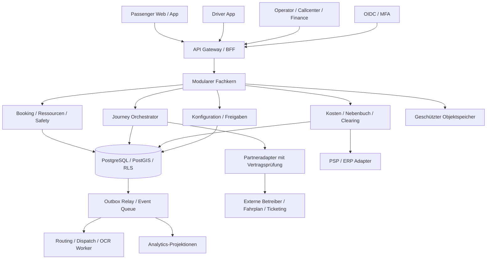

# 01 – Softwarearchitektur und Betriebsmodell

## 1.1 Verbindlichkeit und Architekturentscheidung

Stand 25.10.2026, Entwurf zur fachlichen Freigabe. Anforderungen des Lastenhefts bleiben maßgeblich; hier gewählte technische Defaults sind Lösungsvorschläge, keine bereits implementierten Fähigkeiten. Offene Geschäftsentscheidungen stehen in [07](07-entscheidungen.md). Die Architektur deckt P1–P3 ab; eine P2-Anforderung wird durch ihre Vorplanung nicht stillschweigend zur P1-Lieferpflicht.

**Empfehlung: modularer transaktionaler Kern, getrennte rechenintensive Worker und streng begrenzte Partneradapter.** Ein Microservice pro Fachmodul würde die Buchungs-, Ressourcen- und Finanzkonsistenz früh unnötig verteilen. Der Kern kann später entlang gemessener Last und Teamverantwortung geteilt werden; bestehende Module kommunizieren bereits über explizite Ports und Ereignisse.

| Baustein | Konkrete Technik / Verantwortung | Auswahlgrund / Grenze |
|---|---|---|
| Passenger Web, Operator, Callcenter | TypeScript, React, responsive PWA; gemeinsames Designsystem | Pflicht-Webkanal; getrennte Rollennavigation, eine Fach-API |
| Driver App; native Passenger App P2 | Flutter; verschlüsselte SQLite-Outbox auf verwalteten Geräten | Mobile Offlineereignisse, Kamera, Navigation, Push; Web ersetzt keine garantierte Hintergrundortung |
| Fachkern | Kotlin, Java 21 LTS, Spring Boot; explizite Modul-APIs | Transaktionen, Typprüfung, Worker und gute JVM-Betriebswerkzeuge |
| Identität | OIDC-Anbieter, bevorzugt verwaltetes Keycloak; MFA, PKCE | Kein eigener Passwort-/Tokenserver; IdP-Wechsel über Standards |
| Primärdaten | PostgreSQL 17 + kompatibles PostGIS, PITR | ACID, RLS, Geo-Indizes, versionierbare Migrationen |
| Cache | Redis, ausschließlich Cache/Rate-Limits | Kein führender Kapazitäts-, Preis- oder Zahlungszustand |
| Hintergrundarbeit | PostgreSQL-Outbox + Inbox; RabbitMQ Quorum Queues | Mindestens-einmal-Zustellung; Persistenz und Wiederaufnahme im Fachkern |
| Routing / Optimierung | Eigenständige Python-Worker, OR-Tools als Solverbaustein; Routingadapter zunächst Valhalla | Time-Windows/VRP und Geo-Routing getrennt; Lizenz, Kartenqualität und Laufzeitbenchmark vor Auswahlfreigabe |
| Dokumente | S3-kompatibler Objektspeicher, Versionierung, geregelte Retention/Object Lock | Originale, Schadensbilder, Exporte; Datenbank hält Metadaten und SHA-256 |
| OCR / Rechnungsprüfung | Austauschbarer OCR-Adapter; KoSIT-Validator für XRechnung; Malware-Scan | OCR ist Vorschlag, strukturierte Rechnungen werden regelbasiert validiert |
| Reporting | Lesereplikat + inkrementelle Projektionen; später getrenntes Warehouse | Reporting und Simulation belasten keine Live-Buchung; Finanzberichte lesen konsistente Abschlusssnapshots |
| Betrieb | OCI-Container, EU-Hosting; verwaltete PostgreSQL-/Objektspeicher-Dienste; deklarative Infrastruktur | P1 vorzugsweise verwaltete Containerplattform; Kubernetes erst bei vorhandener Betriebskompetenz |
| Telemetrie | OpenTelemetry, Prometheus-kompatible Metriken, strukturierte Logs | Korrelations-IDs; keine Fahrgastkontakte in Metriklabels |

Die Major-Versionen bilden den Implementierungsstartpunkt, keine langfristige Versionsfixierung. Vor Implementierung sind unterstützte Patchstände, CVEs, Lizenzen und Kompatibilität in BOM/Lockfiles festzuschreiben. Ein Technologie-Spike muss Driver-Offlinemodus, PostGIS, Solverzeit und PSP-Sandbox belegen. Die Auswahl ist keine Behauptung getesteter Laufzeitsoftware in diesem Repository.

## 1.2 Komponenten und Vertrauensgrenzen

Kein Client greift direkt auf Datenbank, Queue oder Partnerzugänge zu. Eine signierte Upload-URL ist auf konkretes Objekt, Mandant, Größe, Typ und kurze Laufzeit begrenzt. Die Quarantäneprüfung erfolgt vor Freigabe. Alle Partnerdaten gelten als unzuverlässige Eingaben: Schema, Signatur, Autorisierung, Duplikate, Zeit und wirtschaftliche Summen werden geprüft.

## 1.3 Domänengrenzen und Transaktionen

| Modul | Führende Aggregate | Transaktionale Zusage / Schnittstelle |
|---|---|---|
| Identity/Policy | Membership, Delegation, PolicyRevision | Rollen/Scope aus serverseitig geprüfter Identität; keine Tenantwahl durch ungeprüfte Header |
| Service/Geo | ServiceRevision, ServiceArea, StopRevision | Nur freigegebene, zum Leistungszeitpunkt wirksame Versionen |
| Booking/Dispatch | Booking, CapacityHold, RunPlanRevision | Sperren und Kapazitäten werden atomar beim Hold/Commit geprüft |
| Journey/Federation | Journey, JourneyLeg, SagaStep, CooperationGrant | Fremde Buchung nur über autorisierten Adapter; keine fremde Fahrzeugdisposition |
| Fare/Payment | QuoteSnapshot, PaymentIntent, RefundCase | Preisbindungen unveränderlich; PSP-Status unabhängig vom Buchungsstatus |
| Fleet/Safety | Vehicle, Inspection, Defect, Release | Sicherheitsblock gilt synchron; Event informiert andere Projektionen |
| Staff/Time | RosterRevision, Shift, Qualification, TimeEvent | Veröffentlichung und Einsatzfreigabe getrennt; keine Diagnosen in Dispositionssichten |
| Documents/Finance | Expense, EconomicEvent, Journal, Allocation, Settlement | Freigabe, ausgeglichener Journalposten und Outbox in einer Transaktion |
| Communication/Support | Case, NotificationAttempt | Retry und Zustellstatus ändern keine Buchungszusage |
| Analytics/Forecast | MetricDefinition, DatasetRevision, Scenario | Reproduzierbare Datenstände; keine Schreibrechte auf Live-Buchungen |

Ein Modul schreibt ausschließlich seine eigenen Tabellen. Synchron benötigte Safety-/Kapazitätsprüfungen laufen im selben Datenbank-Transaktionsbereich des lokalen Betreibers; asynchrone Projektionen dürfen diese Prüfung nicht ersetzen. Erforderliche Modulzugriffe werden als explizite Fachoperation implementiert. PSP- und Partneraufrufe erfolgen außerhalb offener SQL-Transaktionen.

## 1.4 Disposition und Kapazität

1. Anfrage auf zulässiges Gebiet, Zeit, Produkt, Berechtigung, Personen und Unterstützungsbedarf prüfen; jeden neuen Versuch mit einer `attempt_id` für Ablehnungsstatistik speichern.
2. Freigegebene Haltepunkte und geeignete Fahrzeuge bestimmen. Sitze, Rollstuhlplätze und Umrüstzustände sind ein Ressourcenvektor, keine einzige Platzanzahl. Fahrzeugwechsel erfordert passende Fahrerqualifikation und neue Prüfung.
3. Einfügeheuristik erzeugt nur Routen, die alle bestehenden Zusagen, Pausen, sichere Fahrzeiten, Ressourcen, Lade-/Reichweitenreserven und maximale Umwege einhalten. Bereits zugesagte Zeitfenster sind harte Constraints. Die gewichtete Optimierung minimiert erst Unzulässigkeit (muss null sein), dann Verletzung weicher Ziele, danach Leerweg/Fahrzeit/Kosten.
4. Angebot enthält Planrevision, Tarif-/Policyversion, `expires_at`, Zeitfenster und dokumentierte Preisbedingungen. Ein Angebot ohne Hold verspricht keine gesicherte Kapazität.
5. Lokaler Hold sperrt die betroffenen Kapazitätsintervalle in stabiler Reihenfolge; prüft Planrevision, Ressourcenvektoren und Safety erneut; schreibt Hold und Outbox atomar. Bei konkurrierender Revision neu planen oder 409 zurückgeben. Redis-Locks sind hierfür nicht ausreichend.
6. Bestätigung konvertiert gültigen Hold in Booking in derselben lokalen Transaktion. Wiederholte Bestätigung findet dieselbe Buchung. Freigaben und Ablauf benutzen denselben Kapazitätslock; am Grenzzeitpunkt gilt Serverzeit `now >= expires_at` als abgelaufen.

Routingbudget als zunächst zu testender Vorschlag: 1 s lokale Kandidatensuche, bis 3 s begrenztes Partner-Fanout, 1 s Zusammenführung/Reserve innerhalb des 5-s-Ziels. Nicht rechtzeitig eintreffende Angebote werden nicht nachträglich als zugesagt dargestellt. Bei Solver-Timeout wird nur ein bereits vollständig validierter zulässiger Plan geliefert; andernfalls begründete Ablehnung. Periodische Verbesserung darf keine bindende Zusage verschlechtern. Exakte Grenzwerte stehen unter D-05.

## 1.5 Ereignisse, Offlinebetrieb und Wiederanlauf

- Jede fachliche Transaktion schreibt Aggregate, Revision und Outbox zusammen. Relay-Verlust wird durch erneutes Lesen aufgeholt. Consumer deduplizieren `(consumer, event_id)` und prüfen die Aggregatrevision.
- Reihenfolge gilt pro Aggregat, nicht global. Lücken werden durch autorisierten Snapshotabruf geschlossen; Finanzverbraucher puffern widersprüchliche Folgeereignisse statt zu raten.
- Driver-App speichert eine verschlüsselte lokale Queue mit `device_event_id`, letzter Serverrevision, Erfassungszeit und Empfangszeit. Bei Sync wird jedes Ereignis einmal wirksam. GPS-Messzeit ist keine trusted Serverzeit.
- Offline sichtbar: zuletzt bestätigter Dienst und Stoppliste mit Stand. Offline erfassbar: Beleg, Schaden, Zeitereignis. Keine neue verbindliche Buchung, Fahrzeugfreigabe oder Aufhebung einer Sperre ohne Serverprüfung.
- Bei widersprüchlichem verspätetem Check-in und serverseitigem Storno entsteht ein Klärfall; das Ereignis wird als historische Beobachtung erhalten, nicht als unkontrollierter Zustandsrücksprung.
- Nach Prozessneustart nehmen Worker persistierte Operationen über Lease/Fencing wieder auf. Externe UNKNOWN-Operationen werden abgeglichen; keine erneute Belastung mit neuer Referenz.

## 1.6 Konfiguration, Statistik und ETA

Konfigurationsreihenfolge: globale Sicherheitsgrenze → freigegebener Mandantenrahmen → Region → Dienst → konkretes Produkt → Fahrzeug. Fahrzeug-/Profiloverrides gelten nur für dafür freigegebene Parameter; Rechts- und Sicherheitsgrenzen bleiben vorrangig. Engere fachliche Limits werden validiert, nicht blind überschrieben. `effective_from/to`, Ersteller, Prüfer, Änderungsgrund und Schema-Version sind Pflicht. Rollback erzeugt eine neue Revision; historische Buchungen referenzieren weiterhin ihre Zusageversion. Die 80 Originalparameter werden im Katalog referenziert; Produktionswerte sind fachlich freizugeben.

Alle 48 KPIs erhalten stabile technische ID, Definitionsversion, Zeitzonen-/Periodenbasis, Zähler, Nenner, Ausschlüsse, Datenqualitätsquote und Datenstand. Null-Nenner wird als „nicht berechenbar“ geliefert. Primärer Ablehnungsgrund zählt einen Versuch nur einmal; Sekundärgründe sind Mehrfachlabels. Betreiberübergreifende Summen nutzen deduplizierte Journey-/Leg-Referenzen und eliminieren interne Umsätze/Kosten nur in freigegebenen Konsolidierungssichten.

Personalisierte ETA ist standardmäßig aus. Grundmodell: rechtmäßige Routingzeit + zugängliche Haltezeit + kalibrierter Unsicherheitspuffer. Fahreranpassung erst nach Freigabe der Rechtsgrundlage, Mitbestimmung, Stichprobengröße, Qualitäts-/Fairnessprüfung und Löschfrist; keine Leistungsrangliste. Rechtswidrig schnelle oder qualitativ unbrauchbare Messungen sind keine Trainingsdaten. Jede Prognose liefert Modellversion, Unsicherheit und Fallbackgrund. Simulation hat separate Daten, Worker, Queue und Ressourcenlimits.

## 1.7 Sicherheit und Datenlebenszyklus

Mandantenisolation gilt in SQL, Storage, Cache-Keys, Suche, Export, Events, WebSockets und Support. RLS schützt vor versehentlich fehlendem WHERE, ersetzt aber keine API-Autorisierung. Backend-Runtime besitzt weder Superuser noch BYPASSRLS noch Tabelleneigentum. Migrationen verwenden einen separaten kurzlebigen Betriebszugang. Fachlich sensible Spalten liegen in eigenen Tabellen und DTOs; ein Tenantadmin bekommt nicht automatisch HR-, Gesundheits- oder Finanzzugriff.

OIDC-Zugriffstokens werden auf Signatur, Issuer, Audience, Ablauf und Berechtigung geprüft; privilegierte Konten benötigen MFA. Token-/Rollenentzug wird über kurze Tokenlaufzeit und serverseitige Sitzungssperre wirksam. Tenantwechsel erfordert geprüfte Mitgliedschaft und serverseitigen Kontextwechsel. Service-Accounts sind pro Adapter und Zweck begrenzt.

| Klasse | Technische Behandlung | Vor Produktion festzulegen |
|---|---|---|
| Kontakt/Unterstützung | Separater Vault/PII-Bereich, feldbezogene Rechte, kurzlebige Weitergabe | Zweck, Rechtsgrundlage, Löschfrist |
| Standort/Driver-ETA | Pseudonymisierung, kurzlebige operative Rohdaten, getrennte Modelle | Betriebsrat/DSFA, zulässige Auswertung und Frist |
| Belege/Journal | Original + Hash, append-only Revisionen, Retention/Legal Hold | Rechtlich freigegebene Dokumentklassen und Aufbewahrung |
| Security-Audit | Append-only Export in getrennte Berechtigungsdomäne, Maskierung | Zugriff, Integritätsprüfung, Aufbewahrung |
| Aggregierte Statistik | Mindestzellgrößen/Unterdrückung kleiner Gruppen | Freigabe für Aufgabenträger und Partner |

Löschung ist ein orchestrierter Job über DB, Objektspeicher, Suchindex und Partnerprojektion. Aufbewahrungspflichtige Finanzbezüge werden von entbehrlicher PII getrennt. Restore spielt Lösch-/Sperrjournal vor Freigabe wieder ein. Produktionsdaten werden nicht in Entwicklung kopiert.

## 1.8 Deployment, Qualität und Lieferung

Getrennte Umgebungen Development, Staging, Performance, Production; separate Secrets, PSP-Konten und Identitätsdomänen. Reproduzierbare Images/SBOM, signierte Artefakte, expand/contract-Migrationen, kompatible Events und gestaffeltes Rollout. DB-Rollback bedeutet bei fachlichen Daten üblicherweise Vorwärtskorrektur, kein Löschen bestätigter Buchungen.

| Ziel aus Lastenheft | Nachweis |
|---|---|
| 99,9 % Kernverfügbarkeit / Monat | Externe synthetische Such-/Buchungsprüfung; getrennte Provider- und Plattformfehler; Wartungsregel D-05 |
| Standard-API p95 ≤ 1 s; Angebote p95 ≤ 5 s | Lasttest mit definiertem Requestmix, Partnerlatenz und Warm-/Cold-Cache |
| 250 Fahrzeuge, 30.000 Buchungen/Tag, 5.000 Sessions je Mandant | Mindestens zwei Mandanten gleichzeitig; Peakfaktor und Mandantenzahl offen, nicht aus Tagesmittel abgeleitet |
| Planupdate p95 ≤ 10 s; Standortalter ≤ 30 s normal | Messung bis Clientdarstellung; Offline/alt sichtbar |
| RPO ≤ 15 min; RTO ≤ 2 h | Verschlüsselte Backups + kontinuierliches WAL; gemessene Wiederherstellung inkl PSP-/Partnerabgleich |

Release-Gates: Schema-/API-Vertragstest, Domäneninvarianten, echte Integrationen in Sandbox, RLS-/Feldzugriffstests, Fault-Injection, mobile Offlinefälle, Barrierefreiheit, Last/Restore und fachliche E2E-Abnahme. P1 enthält ausdrücklich DOC-/FCO- und Safety-/Personal-MUSS-Anforderungen des erweiterten Lastenhefts. Alle Module einschließlich P2/P3 sind in der Matrix enthalten; Prioritäten werden nur durch dokumentierten AG-Beschluss geändert.
