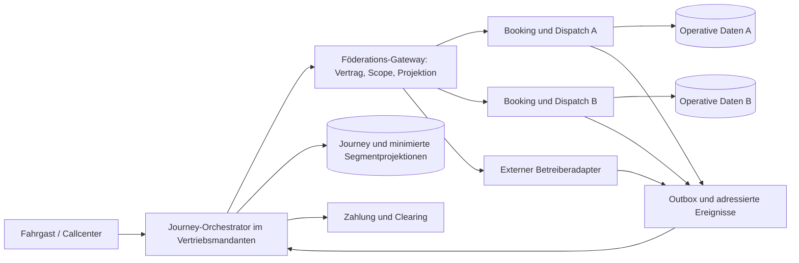
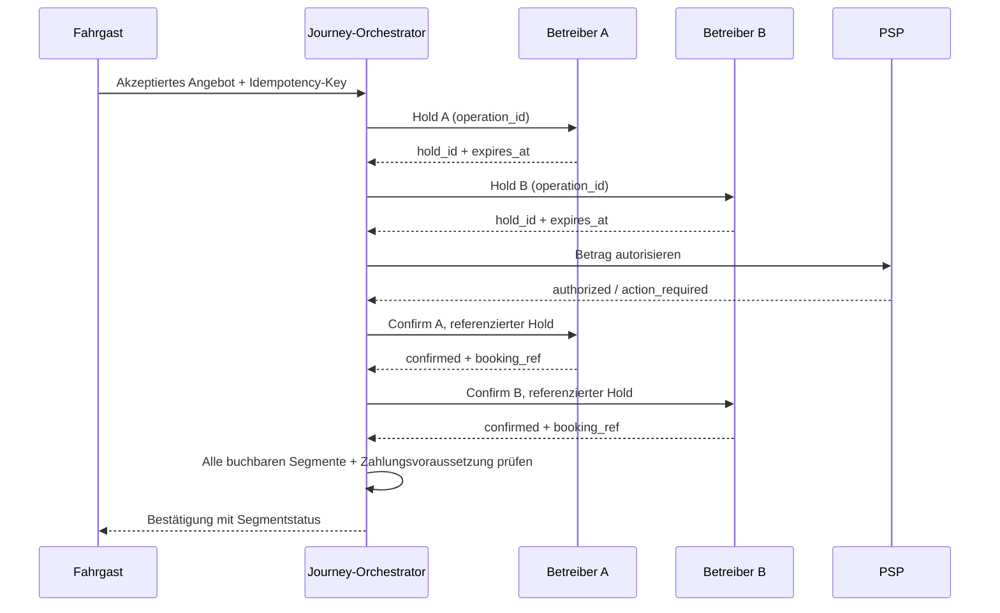

# Mandantenübergreifende Datenarchitektur und Reiseketten

Status: technischer Entwurf zur fachlichen Freigabe, 25.10.2026. Die folgenden Festlegungen konkretisieren insbesondere SYS-001, IAM-005, SEC-001/004/016, MUL-001–025, FED-001–033, I.9/COM-001 und I.9/COM-011 und GOV-009. Alle genannten Grenzwerte sind testbare Planungsdefaults; sie sind keine bereits gemessenen Produktfähigkeiten. Kaufmännische und rechtliche Entscheidungen bleiben im Entscheidungsregister freizugeben.

## 1. Verbindliche Architekturgrenzen

Die Plattform setzt zunächst eine gemeinsame PostgreSQL-Datenbank mit logisch getrennten Domänen, mandantenbezogenen Schlüsseln und Row Level Security (RLS) ein. Eine aktive Kooperation erzeugt ausdrücklich freigegebene Projektionen und API-Rechte. Sie verschafft keinem Betreiber direkten Tabellenzugriff auf den anderen Mandanten. Der lokale Booking-/Dispatch-Kern bleibt einzige Autorität für die Kapazität seines Betreibers. Der Journey-Orchestrator verbindet Angebote und Aufträge, erteilt aber keine fremde Fahrzeugzuweisung.

Jede Datenbanktabelle hat einen fachlich benannten Eigentumskontext. Bei plattformweiten, nicht personenbezogenen Katalogobjekten ist dies ein expliziter Plattformmandant; `tenant_id IS NULL` bedeutet niemals „für alle sichtbar“. Plattformweite technische Metadaten, etwa Migrationsstände, sind getrennt von Fachdaten. Das realisiert MUL-001 ohne aus gemeinsam genutzten Haltestellen eine Freigabe von Buchungs- oder Personalakten abzuleiten.

Eine Auskunftsverbindung ohne Ticket-/Buchungsrecht wird ausschließlich als `INFORMATION_ONLY` oder `EXTERNAL_BOOKING` dargestellt. Die Reisekette darf einen solchen Abschnitt enthalten; weder API noch Oberfläche zählen ihn als von TAKTOVIA gebucht.

## 2. Identitäten, rechtliche Rollen und Eigentum

| Begriff | Persistierte Bedeutung | Beispiel / Integritätsregel |
|---|---|---|
| `Tenant` | Daten-, Autorisierungs- und Konfigurationsgrenze; nicht automatisch eine juristische Person | Zwei Betreiber besitzen A und B. Ein Aufgabenträger hat einen eigenen Kontext mit nur freigegebenen Berichten. |
| `LegalEntity` | Rechtsträger mit Rechnungs-/Steueridentität und Rechtsraum | Eine GmbH kann mehrere Betriebsorganisationen führen; historische Rechnungen verweisen auf ihren damaligen Snapshot. |
| `Organization` | Fachliche Organisation mit zeitlich gültigen Rollen und Referenz zum Rechtsträger | Plattformanbieter, Beförderer, Vermittler, Fahrzeugsteller und Kostenträger werden getrennt geführt. |
| `Membership` | Nutzerzuordnung zu Tenant, Rolle und Diensten, zeitlich begrenzt | Ein Planer darf Depot A verwalten; ein globaler Login verleiht keine globalen Datenrechte. |
| `PartnerContractVersion` | Freigegebene Parteien, Leistungen, Gebiet, Laufzeit, Datenzwecke, Haftungs-/Abrechnungsregeln | Unveränderlicher Stand je Buchung; Widerruf betrifft Rechte trotz historisch vorhandenen Vertrags. |
| `CooperationGrant` | Technische Rechte aus einem Vertrag: Subject, Empfänger, Scope, Dienste, Felder, Zweck, Gültigkeit | `offer:read` verleiht weder `hold:create` noch `booking:confirm`. |
| `PassengerAccount` | Konto und Kontaktkanäle im Konto-/Vertriebskontext | Der globale Reisebezug bleibt pseudonym; Betreiber erhalten zusätzliche, voneinander getrennte Aliasse. |
| `ResourceAssignment` | Zeitlich gültige Verwendung von fremdem Fahrzeug oder Fahrer | Eigentum, Einsatzbetreiber, Personal-Arbeitgeber und Abrechnungspartner sind unabhängige Attribute. |

Organisationen werden nicht durch unkontrollierten Austausch von Stammdaten dupliziert: Ein kontrolliertes Organisationsverzeichnis enthält nur freigegebene Identifikatoren und veröffentlichte Firmeninformationen. Steuerliche Dokumente, Verträge, Personalakten und Konditionen liegen weiterhin im jeweiligen Eigentumskontext. In einer Mehrparteienbuchung werden Verkäufer, Vermittler, ausführender Beförderer, Fahrzeugsteller, Kostenträger und Zahlungsempfänger als getrennte Rollen mit versioniertem Bezug gespeichert (MUL-003/004/010).

Ein Eigentümerwechsel am Fahrzeug ändert laufende Stammdatenzuordnungen ab Wirksamkeitsdatum. Abgerechnete Runs behalten die Rollen-/Vertragssnapshots zum Leistungszeitpunkt. Eine Fremdfahrzeugfreigabe erlaubt dem Einsatzbetreiber nur das freigegebene Fahrzeugprofil, Kapazitäten, Einsatzzeitraum und bestätigte Einsatzfähigkeit. Einkaufspreis, vollständige Schadenhistorie, Gehaltsdaten und Eigentümerfinanzbuchhaltung werden dadurch nicht sichtbar. Die Freigabe eines Fahrers enthält ausschließlich nötige Qualifikationen, zeitliche Einsatzberechtigung und Kontaktkanal; Pflichtprüfung und gesetzliche Einsatzgrenzen bleiben wirksam (MUL-005, E2E-094/095).

## 3. Datenebenen und erlaubte Sichtbarkeit

| Ebene | Führender Kontext | Inhalt | Empfänger und Begrenzung |
|---|---|---|---|
| Identität | Konto-/Identitätsdienst | OIDC-Subject, Kontoverknüpfung, Kontakt und Präferenzen | Clients nur eigenes Konto; Dienstleister nur zweckgebundene Teilinformationen |
| Operativer Bestand | Je Betreiber-Tenant | Fahrer, Schichten, Fahrzeuge, lokale Buchungen, Kapazität, Tarife, Belege | Eigene Rollen und Dienste; kein Partner-SQL-Zugriff |
| Gemeinsamer Angebotskatalog | Plattformkatalog plus Veröffentlichungen | Gebietsgeometrie, zugelassene Hubs, öffentliche Betriebszeiten, Capability-Profil, Aktualität | Vertragsabhängig freigegebene Partner; keinerlei aktuelles persönliches Fahrtprofil |
| Journey-Koordination | Verkaufs-/Vermittlungs-Tenant | Reise, Segmentfolge, Zusagen, Preise, Referenzen, Gesamtausführungsstatus | Fahrgast eigene Reise; Koordinator gesamte eigene Reise; Betreiber nur sein Segment und notwendige Übergabe |
| Finanzbestand | Je buchführendem Rechtsträger/Tenant | Eigene Belege, Journale, Abrechnungen, Partnerforderungen | Eigene Finanzrolle; Partner erhält eine explizite Gegenabrechnung, keine Journal-Vollsicht |
| Verbundauswertung | Freigegebene Reportingprojektion | Aggregierte Leistungs-, Übergabe- und Qualitätskennzahlen | Aufgabenträger je genehmigtem Gebiet/Zeitraum, mit Mindestgruppengröße und Unterdrückung kleiner Zellen |

**Minimaler Betreiberpayload**: Segmentreferenz; Partner-Fahrgastalias; Start-/Zielhaltestelle; vereinbartes Zeitfenster; Personenzahl und benötigte Kapazitätsmerkmale; Boarding-Code; erforderliche Unterstützung ohne Diagnose; Kontaktrelay oder freigegebener Notkontakt; vertraglich nötiger Tarif-/Ticketnachweis. Eine volle Reisekette, komplettes Fahrgastkonto, Kartentoken, Kreditkartendaten, fremde Rechnungen oder personenbezogene Vorgeschichte sind ausgeschlossen (MUL-021; FED-013/026/027).

Für Anschlusssicherung erhält Betreiber B aus A ausschließlich `transfer_hub_id`, voraussichtliche Ankunft, zugesagtes Übergabefenster, erforderliche Umsteigezeit, notwendige Assistenz und Aktualitätsindikator. Der Fahrgast ist in der Koordination global pseudonym referenziert, die an A/B ausgegebenen Aliasse sind paarweise verschieden. Das verhindert freie Verknüpfung der Kundenbestände. Kontaktvermittlung verwendet einen Reise-/Segment-Relay mit Ablaufzeit. Ein persönliches Merkmal wird nur übertragen, wenn Dienst, Vertrag, Zweck und Rechtsgrundlage es erlauben.

## 4. Autorisierung und technische Isolation

### 4.1 Anfragekontext

1. Das Gateway validiert Token-Signatur, Aussteller, Audience, Ablauf und zulässige Authentisierung. Für Mitarbeiter gelten OIDC und MFA; Partner bekommen eigene Maschinenidentitäten und schmale OAuth-Scopes.
2. Ein Client darf einen gewünschten Tenant wählen. Der Server verifiziert dafür eine aktuelle Membership und die Freigabe des Dienstes; ein `tenant_id` im Body, Pfad oder Header ersetzt diesen Nachweis niemals.
3. Das Backend erzeugt einen unveränderlichen RequestContext aus Akteur, aktivem Tenant, Scope, zulässigen Diensten, Zweck und Vertragsrevision. Personenbezogene Kontexte werden nicht in Logs kopiert.
4. Der Datenbankzugriff läuft in einer Transaktion. Tenant-/Akteurkontext wird transaktionslokal gesetzt und nach Ende nicht in den Connection Pool übernommen. Ohne Kontext gilt deny-by-default.
5. Objektoperationen prüfen zusätzlich Rollen, Feldrechte, Dienst, Status und Zweck. RLS ersetzt diese fachlichen Prüfungen nicht. Nicht sichtbare Objekt-IDs liefern nach außen 404; interne Auditdaten unterscheiden fehlend und verweigert ohne Informationen an den Anfragenden zu leiten.

RLS mit einer vom Backend gesetzten Sessionvariablen ist eine zweite Schutzschicht gegen vergessene Tenantfilter, kein Schutz gegen kompromittiertes Backend mit beliebiger SQL-Ausführung. SQL-Injection-Abwehr, parametrisierte Queries, keine direkten Kundendatenbankzugänge und getrennte Dienstrollen bleiben verpflichtend. Strenge regulatorische Isolation kann deshalb dedizierte Datenbanken erfordern.

### 4.2 PostgreSQL-Regeln

- Alle tenantlokalen Primär-/Unique-/Fremdschlüssel enthalten `tenant_id`; lokale Relationen dürfen keinen alleinigen `id`-Fremdschlüssel verwenden. Das verhindert die Zuordnung eines Belegs A zu einem Fahrzeug B auch bei falscher Anwendungseingabe.
- RLS wird mit `ENABLE ROW LEVEL SECURITY` und `FORCE ROW LEVEL SECURITY` aktiviert. Runtime-Rollen sind keine Tabellenowner, keine Superuser und besitzen kein `BYPASSRLS`; Migrationen laufen unter gesonderten, im Normalbetrieb nicht verfügbaren Rollen.
- Policies begrenzen sowohl `USING` als auch `WITH CHECK`. Eine Änderung der Eigentums-Tenant-ID ist kein normales Update und wird verweigert.
- Interne Föderationsdienste besitzen keinen pauschalen RLS-Bypass. Sie lesen den eigenen Journeybestand und rufen Partnerdomänen mit genehmigtem Auftrag auf. Freigegebene Projektionen werden beim Eigentümer erzeugt und unter Empfängerkontext gespeichert.
- Row-Security schützt weder automatisch jede View noch referentielle Prüfungen. Views verwenden invokergerechte Rechte; Definerfunktionen werden vermieden oder mit festem `search_path`, minimalen Rechten und separaten Tests versehen. DB-Constraint-Fehlermeldungen gelangen nicht roh zur API.
- Tabellen-/Zeitpartitionierung ist ausschließlich Performance-/Retentionmechanik. Sie ist keine Sicherheitsgrenze. RLS und Constraints müssen bei Partitionzugriff und Wartungsjobs nachweislich erhalten bleiben.
- Hintergrundjobs tragen einen expliziten Tenantkontext. Batchjobs iterieren begrenzt pro Tenant; ein Reportingauftrag hebt nicht die operativen Schutzregeln auf.

### 4.3 Isolation außerhalb der relationalen Datenbank

Cache-Schlüssel enthalten Tenant, Dienst, Ressourcen-ID und für Freigaben eine Policyrevision. Objektstorage trennt Tenants in Zugriffspolicies und Präfixen; signierte Downloads werden erst nach Objekt-/Zweckprüfung erzeugt und gelten als Default höchstens 60 Sekunden. Widerruf löscht keine gesetzlich zu archivierenden Belege; er sperrt den Downloadpfad. Personenbezogene Notfallzugriffe verwenden einen kontrollierten Proxy statt nicht widerrufbarer Langzeitlinks.

Suchindizes, Websocket-/SSE-Kanäle, Queue-Nachrichten, Exporte und Analytik übernehmen dieselben Grenzen. Events enthalten die Eigentums-Tenant-ID und eine explizite Empfängeradressierung; der Eventbus ist keine frei abonnierbare Gesamtdatenquelle. Sensitive Payloads werden je Empfänger aus erlaubten Feldern erzeugt. Plattformadministration verwaltet Konfiguration ohne automatische Fachdatensicht. Ein Break-glass-Zugriff erfordert Anlass, begrenzte Dauer, verantwortliche Freigabe und nachträgliche Auditkontrolle (MUL-018).

## 5. Vertrag, Pause und Widerruf

Ein Vertrag durchläuft `DRAFT → REVIEWED → ACTIVE → PAUSED/EXPIRED/REVOKED`. Beidseitig genehmigte Fassung, technische Capability-Prüfung und Rechtsfreigabe sind Voraussetzungen für `ACTIVE`. Daten-, Auskunfts-, Buchungs-, Zahlungs- und Clearingrechte werden getrennt aktiviert. Zeitfenster sind halboffen `[valid_from, valid_until)`; Vertrags-/Policyprüfungen verwenden Serverzeit.

| Ereignis | Neue Auskunft/Buchung | Bestehende Reisen | Daten-/Finanzfolge |
|---|---|---|---|
| Geplante Partnerpause | Ab Pause keine neuen Angebote/Holds | Bereits zugesagte Segmente weiter abwickeln | Nur erforderliche Restabwicklung und historische eigene Nachweise |
| Vertragsablauf | Ab Ablauf keine Neuanlage | Vorher vertraglich geregelter Auslaufprozess; scopebegrenzter Restabwicklungsgrant | Zulässige Abrechnung, Erstattung, Nachweisaufbewahrung bleiben gesondert geregelt |
| Fachlicher Entzug einzelner Dienste | Betroffene Dienste sperren | Betroffene Reisen markieren und verantwortliche Leitstelle informieren | Andere Rechte bleiben nur soweit aktiv erlaubt |
| Sicherheitswiderruf/kompromittierter Zugang | Sofort sperren, Tokens/Keys unwirksam | Keine Weiterverwendung des kompromittierten Zugangs; Incident und Notabwicklung über neuen kontrollierten Kanal | Reconciliation, Rebooking/Erstattung nach Freigabe; vorhandene Dokumentationspflichten gesondert erfüllen |

Der unveränderliche Vertragsstand einer Buchung beschreibt die damaligen wirtschaftlichen Bedingungen. Er ist **keine dauerhafte Zugriffsberechtigung**. Laufende Abwicklung erfordert ein weiterhin gültiges, engeres Recht, das nur bekannte Journey-/Segment-IDs, Status, Storno und notwendige Kommunikation umfasst. Ein Pausenflag darf nicht still bestätigte Fahrten löschen. Ein Sicherheitswiderruf darf nicht wegen bestehender Fahrten ignoriert werden. Beide Verhaltensweisen werden separat abgenommen (MUL-014; I.9/COM-011).

Revocation-Prüfung erfolgt für jede geschäftswirksame Partneroperation online gegen den Grantstatus. Ein veraltetes Zugriffstoken allein reicht nicht. Laufende Schreibvorgänge prüfen unmittelbar vor dem lokalen Commit die Grantrevision; externe bereits abgesandte Operationen werden nicht als rückwirkend ungeschehen behandelt, sondern als In-flight-Fall abgeglichen. Entzogene Projektionen werden für den operativen Zugriff gesperrt; Lösch-/Archivregeln entscheiden anschließend über Speicherfristen.

## 6. Föderierte Planung und Angebotsbildung

1. Der Journey Planner ermittelt aus Bediengebieten und genehmigten Transfer-Hubs einen gerichteten Reisegraphen. Ausschlusszonen, Servicezeiten, Verkehrsmodell, Assistenzkapazität und barrierefreie Übergänge sind harte Filter. Gebietspolygone allein erlauben keine Fahrt.
2. Der Anbieterfilter prüft aktive Kooperation, dienst-/gebietsbezogene Rechte, Partnerpause und Capability-Profil. Überlappende Angebote bleiben getrennte Alternativen; dieselbe Fahrzeugkapazität wird ausschließlich beim Eigentümer gehalten.
3. Unabhängige Partnerabfragen laufen begrenzt parallel. Default für einen Partner: 1.500 ms bis zur ersten Auskunft, 3.000 ms gemeinsames Partnerfenster innerhalb von 5.000 ms Gesamtbudget der planenden API (1.000 ms lokale Planung, 1.000 ms Integration/Reserve). Langsame Partner werden als `PARTNER_UNAVAILABLE` mit Aktualitätsstatus ausgewiesen; lokale Angebote bleiben nutzbar. Diese Budgets werden im vereinbarten Referenzlasttest und je Partnervertrag kalibriert.
4. Ein Umstieg ist nur zulässig, wenn `arrival_latest(A) + transfer_duration(accessibility, hub) + risk_buffer <= departure_earliest(B)`. Gemeinsame Haltestellen-ID ersetzt weder Fußweg noch Aufzug-/Stufenprüfung. Bei nicht garantierten Fahrplandaten wird die Unsicherheit sichtbar; Anschlussgarantie ist ein eigenes Vertragsmerkmal.
5. Jede Alternative enthält geordnete Segmente, Verkehrsmittel, Betreiber, Buchungsmodus, Angebots-/Tarifrevision, Preisbestandteile, Zusagefenster, Umstiegsminimum, Ablaufzeit und Stornobedingungen. Angebote sind zunächst unverbindlich.
6. Ranking wendet zuerst Sicherheit und Zulässigkeit an, danach Nutzerpräferenz, Reisezeit, Umstiege, Preis, Qualität und explizit dokumentierte Vertragsregeln. Eine Rankingrevision und wesentliche Gründe werden gespeichert; bezahlte Bevorzugung wird nicht als objektiv schnellste Reise ausgegeben (FED-033).

Die tatsächliche Reisebuchung referenziert unveränderliche Angebote und den vom Kunden akzeptierten Gesamtpreis. Ändert sich ein Preis, Termin oder Vertrag wesentlich, wird ein neues Angebot zur erneuten Zustimmung erzeugt. Ein abgelaufenes Angebot wird nicht unter unverändertem Frontendpreis automatisch neu gekauft.

## 7. Buchungssaga und lokale Konsistenz

### 7.1 Führende Objekte

`Journey` gehört dem Vertriebsmandanten. `JourneyLeg` repräsentiert aus dessen Sicht ein Segment mit externer oder interner Betreiberreferenz; es ist keine zweite Kapazitätsbuchung. Die echte `Booking` gehört dem ausführenden Betreiber. Verbindungen über Tenant-/Systemgrenzen verwenden opake Föderationsreferenzen und versionierte Nachrichten; ein direkter SQL-Fremdschlüssel in fremde operative Daten wird vermieden. Für Diagnose werden `correlation_id`, `saga_id`, `leg_id` und `partner_operation_id` gespeichert.

Der Orchestrator persistiert vor jedem externen Schritt den Intent und einen deterministischen Operationsschlüssel. Danach schreibt er Erfolg/Fehler und Outbox-Ereignis in einer lokalen Transaktion. Der Worker kann aus diesem Zustand nach Prozessneustart weiterarbeiten. Eine Outbox garantiert atomar lokalen Zustandswechsel plus spätere Publikation; sie garantiert nicht Exactly-once über ein Netzwerk. Inbox-Deduplikation und idempotente Geschäftsschlüssel stellen die einmalige Wirkung her.

Die lokale Betreiberbuchung reserviert Kapazität und speichert den Hold atomar. Kapazität wird auf sämtlichen betroffenen Run-Abschnitten und allen Dimensionen geprüft (Sitz, Rollstuhlplatz, notwendige Ausstattung). Die Engine sperrt bzw. versioniert die betroffenen Kapazitätsabschnitte in stabiler Reihenfolge; parallel bestätigte Revisionen werden neu bewertet. Ein bloßer globaler Zähler für „freie Sitze“ reicht bei Pooling nicht. Beim Ablauf und beim Confirm wird die Ablaufzeit erneut serverseitig geprüft. Ein Hintergrund-Expiryjob beschleunigt Freigaben, ist aber nicht die einzige Ablaufprüfung.

### 7.2 Ablauf

Planungsdefault für interne Holds: 180 Sekunden, verlängert nur bei erneuter Kapazitätsprüfung. Der Journey-Orchestrator verwendet das früheste Partnerablaufdatum und reserviert mindestens 15 Sekunden Restbudget vor Beginn der Commitphase; reale Partnerfristen können kürzer sein und führen dann zur Ablehnung oder Neuplanung. Gleichzeitige Holds sind für unabhängige Segmente möglich; Confirmreihenfolge bevorzugt vertraglich gut kompensierbare Segmente. Bei SCA/3-D Secure wird `ACTION_REQUIRED` ausgewiesen. Dauert die Freigabe länger als der Hold, werden keine abgelaufenen Plätze bestätigt; das Angebot muss neu geprüft werden. Eine nachträgliche erfolgreiche Autorisierung wird gegebenenfalls wieder aufgehoben.

Für Vorausbuchungen wird die PSP-Autorisierung nicht unzulässig bis zum Reisetag als garantiert angenommen. Das gewählte, PSP- und vertragskonforme Modell nutzt gegebenenfalls tokenisierte spätere Zahlung oder rechtzeitig erneute Autorisierung. Der Kunde wird über den gültigen Zahlungsplan informiert. Der Zeitpunkt von Capture, Haftung bei Zahlungsfehler nach Segmentbestätigung und Umgang mit fehlender gemeinsamer Autorisierung sind AG-Entscheidungen aus dem Kosten-/Zahlungsmodell.

### 7.3 Getrennte Statusdimensionen

| Objekt / Dimension | Zustände | Freigabebedingung |
|---|---|---|
| Journey-Buchung | `HOLDING`, `HELD`, `ACTION_REQUIRED`, `CONFIRMING`, `RECONCILING`, `CONFIRMED`, `PARTIAL`, `COMPENSATING`, `FAILED`, `CANCEL_PENDING`, `CANCELED`, `COMPLETED` | `CONFIRMED` erst nach bestätigten buchbaren Segmenten und erfüllter Zahlungsvoraussetzung; Entwurf/Angebot sind vorgelagerte Objekte |
| Journey-Ausführung | `NOT_STARTED`, `IN_PROGRESS`, `TRANSFER_AT_RISK`, `DISRUPTED`, `COMPLETED`, `PARTIALLY_COMPLETED`, `ABANDONED` | Bestätigte Buchung bleibt als historischer Vertrag bestehen, auch bei späterer Störung |
| Segment-Buchung | `OFFERED`, `HOLDING`, `HELD`, `CONFIRMING`, `UNKNOWN`, `CONFIRMED`, `FAILED`, `CANCEL_PENDING`, `CANCELED`, `COMPLETED`, `INFORMATION_ONLY`, `EXTERNAL_REQUIRED` | Timeout führt zu `UNKNOWN`; Ablehnungs-/Ablaufgrund bleibt im Fehlercode erhalten |
| Segment-Ausführung | `PLANNED`, `APPROACHING`, `BOARDED`, `COMPLETED`, `NO_SHOW`, `DISRUPTED` | Betreiberstatus führt; keine UI-abgeleitete Erfüllung |
| Operation | `QUEUED`, `RUNNING`, `RECONCILING`, `SUCCEEDED`, `FAILED`, `MANUAL_REVIEW` | Manuelle Prüfung ist Operationsstatus; Journey bleibt bis zur fachlichen Klärung z. B. `RECONCILING` |
| Zahlungsstatus | Eigener Automat: offen, Autorisierung erforderlich, autorisiert, eingezogen, Erstattung ausstehend/erfolgt, fehlgeschlagen | Kein impliziter Gleichlauf mit Journey-/Segmentstatus |

Die API darf die Dimensionen in gleichwertige dokumentierte Statusfelder aufteilen. Sie darf unbestimmte Ergebnisse nicht in ein Erfolgs- oder Fehlerboolean verlieren. Bei gemischten Reisen bedeutet `CONFIRMED` ausschließlich: alle als durch die Plattform buchbar angebotenen Segmente sind bestätigt. Zusätzlich muss `coverage = PLATFORM_SEGMENTS_ONLY` angezeigt werden, sobald Informations- oder externe Checkout-Segmente enthalten sind. „Gesamte Reise gebucht“ ist in diesem Fall unzulässig.

### 7.4 Fehler- und Wiederanlaufvertrag

| Fehler | Persistierter Zustand und nächste Aktion | Nutzerwirkung |
|---|---|---|
| B lehnt Hold ab; A ist gehalten | A freigeben; Zahlung noch nicht starten; Journey `COMPENSATING`, danach `FAILED` | Keine Zusage, alternative Reise anbieten |
| A bestätigt; B lehnt eindeutig ab | A gemäß vorab akzeptierter Saga-/Stornopolicy kompensieren; unbestätigte Holds freigeben; Autorisierung aufheben bzw. Erstattung einleiten | Teilzusage und eventuell verbleibende Kosten sofort sichtbar; keine stille Teilbuchung |
| Confirm B läuft in Timeout | B `UNKNOWN`, Journey `RECONCILING`; Status über unveränderte Operations-/Idempotenzreferenz abfragen | „Bestätigung wird geprüft“; Button erzeugt keine zweite Reise |
| B hat keine Status-/Deduplikationsfähigkeit | Kein automatischer erneuter nicht-idempotenter Kauf; Partneradapter in `MANUAL_REVIEW`; Betrieb alarmieren | Keine definitive Ablehnung behaupten, solange Buchung möglich ist |
| Paymentautorisierung abgelehnt | Holds freigeben; Journey schlägt fehl | Keine Segmentbestätigung, alternative Zahlungsart möglich |
| PSP-Timeout | Zahlungsstatus `UNKNOWN`; PSP-Referenz und Status abgleichen, kein neuer Charge-Key | Zahlungsprüfung anzeigen; keine Doppelbelastung |
| Capture nach bestätigten Segmenten fehlgeschlagen | Zahlungsnachforderung/Klärfall nach gewähltem Modell; neue Fahrt nicht automatisch erzeugen | Betreiberzusagen und offene Zahlung getrennt ausweisen |
| Storno A bestätigt, Storno B unklar | `CANCEL_PENDING` und Segmentstatus einzeln speichern; B abgleichen | Nur bestätigte Erstattungen als abgeschlossen anzeigen |
| Rückerstattung scheitert | Journey kann storniert sein, Refund bleibt offen; Retry nach PSP-Regeln/Finanzalarm | Offenen Betrag und Bearbeitungsstatus nennen |
| Prozessneustart nach externem Erfolg vor lokalem Commit | Persistierten Intent aus Outbox/Saga laden; externe Wirkung per Operationsschlüssel abgleichen | Kein zusätzlicher Kauf; Zustand nach Wiederanlauf konsistent |

Ein Bestätigungs-Timeout wird nicht durch Ablauf des ursprünglichen Holds als Nichterfolg bewiesen: Der Partner kann den Hold rechtzeitig bestätigt haben. Maßgeblich ist ein eindeutiger Partnerstatus oder ein dokumentierter manueller Abgleich. Reconciliation verwendet begrenztes exponentielles Backoff mit Jitter, zunächst etwa 1/2/4/8 Sekunden, danach partnervertragskonforme Intervalle. Nach 60 Sekunden unbestimmtem Buchungszustand wird als Planungsdefault die Leitstelle alarmiert; das ist eine Eskalationsfrist, keine automatische Ablehnung. Dead-letter-Datensätze bleiben bearbeitbar und werden mit dem Originalschlüssel erneut verarbeitet.

Die operative Standardpolicy ist „nur vollständige buchbare Kette bestätigen“. Ein kostenpflichtig verbleibendes Teilsegment benötigt eine vorab akzeptierte kommerzielle Regel und sichtbare Kundennachricht. Können die Partner weder holden noch sicher kompensieren, wird die Kombination für einen verbindlichen Komplettkauf nicht freigeschaltet. Alternativ sind getrennte Käufe mit ausdrücklicher Zustimmung oder externer Checkout möglich. Die Plattform verspricht keine verteilte ACID-Transaktion über Fremdsysteme.

## 8. Ereignisse, Aktualität und anschließende Störungen

Jedes Event führt `event_id`, `owner_tenant_id`, `aggregate_id`, `aggregate_version`, `type`, `schema_version`, `occurred_at`, `recorded_at`, `correlation_id` und freigegebene Empfänger. Inbox-Unique-Key ist mindestens `(partner_id, event_id)`. Signierte Webhooks verwenden einen vereinbarten Algorithmus, Key-ID, Zeitfenster und Replay-Prüfung über den Rohbody; Schlüsselrotation erlaubt einen begrenzten Übergang. Unbekannte Schema-/Signaturversionen werden isoliert statt still interpretiert.

Bei lückenhafter oder veralteter Partnersequenz wird der aktuelle autoritative Status abgefragt. Zeitstempel allein sind keine ausreichende Reihenfolge bei Uhrabweichungen. Ein verspätetes `confirmed` darf nach erfolgreichem `cancelled` nicht rückwärts buchen; widersprüchliche Nachrichten erzeugen einen Klärfall. Events übermittelt der Broker mindestens einmal; erneute Zustellung darf weder zweiten Refund noch doppelte Clearingposition erzeugen.

Anschlussrisiko wird gegen die gespeicherte Zusageversion und aktuelle, qualitätsbewertete ETA berechnet. Die Oberfläche zeigt Datenalter und Ursache. Bei Verzögerung entstehen zulässige Optionen: vertraglich erlaubtes Warten, alternative Verbindung, Ersatzpartnerangebot, Kundenstorno oder Leitstellenentscheidung. Ein Ersatzsegment wird erst nach neuem Angebot, benötigter Zustimmung und bestätigter Buchung als zugesagt angezeigt. Preisdelta, Stornokosten und Haftung werden im Kostenmodell separat erfasst. Die alte Segmenthistorie wird nicht überschrieben.

## 9. Partnerfähigkeiten und Standards

Jeder Adapter besitzt eine freigegebene Capability-Matrix: Standard und Version, Discovery, Auskunft, bindende Preise, Hold, Holdverlängerung, Confirm, deduplizierte Requests, Statuslookup, Storno, Refund, Ticketausgabe, Echtzeit, Signaturverfahren, bekannte Quoten und Sandboxnachweis. Capability ist dienst- und teilweise produktbezogen, nicht pauschal ein Merkmal des ganzen Partners.

| Anbindung | Einsatz und Empfehlung | Entscheidende Grenze |
|---|---|---|
| Interner TAKTOVIA-Adapter | Referenzadapter für andere Plattformmandanten; derselbe Föderationsvertrag wie extern | Keine direkte Manipulation fremder Fahrzeug-/Buchungstabellen |
| TOMP-API | **Favorit für On-Demand-/MaaS-Partner**, wenn deren Profil den benötigten Flow unterstützt | Die aktuelle offizielle Dokumentation beschreibt unterschiedliche Bestätigungsarten; ein TOMP-Label beweist keinen kompatiblen Hold-/Confirm-Flow |
| OSDM | **Favorit für buchbare Bahn-/ÖPNV-Vertriebsprodukte**, soweit Partnervertrag und Implementierung passen | Retailer-/Distributorrollen und Tickets/Reservierungen unterscheiden; konkreten Standardrelease und Flow vor Integration pinnen |
| GTFS/GTFS-RT, NeTEx/SIRI und VDV | Fahrplan, Haltestelle, Kalender, Echtzeit; je vorhandener Datenlizenz und Partnervertrag | Fahrplan-/Realtimefeed ist keine Buchungs- oder Zahlungserlaubnis |
| Proprietäre API | Zulässig hinter demselben internen Adaptervertrag | Zusätzliche Mapping-/Conformancetests; unbekannte Zustände fail closed |

Externe Standardversionen werden je Adapter im Contract-Test fixiert, nicht zur Laufzeit über `latest` geladen. TOMP und OSDM sind keine konkurrierenden Ersatzoptionen für jeden Partner: die Capability-Prüfung entscheidet. Der Architekturentwurf setzt keinen öffentlich nicht nachgewiesenen konkreten Betreiberzugang voraus.

## 10. Abnahme und offene Freigaben

Die folgenden Zusatzfälle sind vor einer produktiven Mehrbetreiberbuchung zwingend und ergänzen die bestehenden Lastenheftfälle.

| Nachweis | Aufbau | Erwartetes Ergebnis |
|---|---|---|
| Mandant A/B, Drittpartner C | A/B kooperieren für Dienst D; C nicht | A sieht nur freigegebene B-Projektion; Rechnung, Foto, Personalakte B bleiben gesperrt; C erhält kein Ereignis (E2E-091/092/101) |
| Falscher Tenant in Body/URL/Cache | Token A plus fremde B-ID | Keine Datenausgabe, kein Schreibeffekt, interner Sicherheitsnachweis; auch bei Connection-Pool-Wiederverwendung |
| Direktzugriff mit Runtime-DB-Rolle | Tenantkontext fehlt/ist A, Abfrage B | Kein B-Datensatz; Foreign-Key-/Unique-Fehler offenbaren keine vertraulichen Felder |
| Letzter Platz parallel | Zwei Journeys halten denselben letzten Abschnittsplatz | Genau eine gültige Reservierung; Kapazität nie negativ (FED-005) |
| Reise A→B | Zwei bestätigte Segmente, zulässiger Transfer | Globale Reise und zwei Betreiberreferenzen, eigene Segmentstatus, korrekte Übergabezeit (E2E-086) |
| A→Linienbus ohne Ticket-API | Bus nur Informationspartner | Bus sichtbar, `coverage=PLATFORM_SEGMENTS_ONLY`, keine fiktive Busbuchung/-zahlung (E2E-087) |
| Confirm angenommen, Antwort verloren | Partner speichert Erfolg, simuliert Timeout | Reconciliation findet Original, kein neuer Kauf, einmalige Zahlung (E2E-089/090/104) |
| Neustart in jedem Saga-Schritt | Worker nach externem Erfolg abbrechen | Persistierter Intent und Partnerlookup konvergieren; keine verlorene Kompensation |
| Ablauf während SCA | Kunde bestätigt Zahlung nach Holdablauf | Kein abgelaufener Platz bestätigt; Autorisierung geprüft und ggf. aufgehoben |
| Widerruf während Buchung | Grant entziehen zwischen Hold und Confirm | Neuer Commit nach Grantprüfung gestoppt; In-flight-Fälle abgeglichen; Incident-/Kompensationspfad |
| Vertragsablauf bei bestehender Zusage | Vertrag endet vor Ausführung | Kein Neugeschäft; dokumentierter enger Auslaufprozess bleibt nach gültiger Rechtsgrundlage möglich |
| Verzögerung und nicht barrierefreier Ersatz | A verspätet, schnellster Weg hat Stufen | Ersatz unzulässig bei Rollstuhlbedarf; zulässige Alternativen/Leitstellenfall, keine unsichere Zusage |
| Reconciliation bleibt unklar | Kein Statuslookup, kein bestätigter Rückruf | `MANUAL_REVIEW`; niemals automatisch „nicht gebucht“ oder „vollständig erstattet“ |

**AG-Freigaben:** (1) Rechtsträger und Rollen pro Dienst, einschließlich Verantwortlichkeit für die Gesamtreise; (2) Haftung/Anschlussgarantie und zulässige Teilkäufe/Kompensationskosten; (3) Datenverantwortlichkeit und konkrete Kooperationsverträge; (4) verpflichtende dedizierte Mandantendatenbanken aufgrund Verträgen oder Schutzklasse; (5) Pilotpartner mit nachgewiesenen Buchungs-/Status-/Stornofähigkeiten. Technischer Favorit ist der oben beschriebene gemeinsame Kern mit expliziten Projektionen und nachrüstbaren dedizierten Tenantdatenbanken. Ohne Freigabe der kommerziellen und rechtlichen Rollen kann die Technik in einer Sandbox abgenommen werden, aber nicht als verbindliches Verkehrs-/Vertriebsangebot produktiv starten.

Quellen, Varianten und konkrete Abrufnachweise stehen in [Recherche Föderation](recherche-federation.md). Das einheitliche Kostenmodell und die API-Verträge spezifizieren die kaufmännischen und maschinenlesbaren Auswirkungen dieser Abläufe ergänzend.
