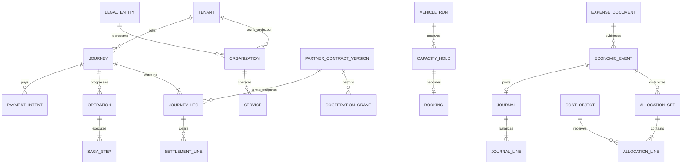

# 04 – Relationales Datenmodell

## 4.1 Konventionen und Artefaktgrenze

Das [SQL-Kernschema](schema/kernschema.sql) konkretisiert die kritischen Mandanten-, Reise-, Buchungs- und Finanzobjekte für PostgreSQL 17/PostGIS. Es ist ein prüfbares Entwurfsartefakt für ein leeres Schema, keine vollständige produktive Migration aller 672 Anforderungen. Die folgende Erweiterungsmatrix spezifiziert die übrigen Tabellen. API-DTOs sind ausdrücklich keine unbeschränkten Datenbankserialisierungen.

- Schlüssel: UUID; lokale Primärschlüssel `(tenant_id,id)`. Alle lokalen Fremdschlüssel enthalten `tenant_id`. Auch Indizes und eindeutige fachliche Referenzen beginnen mit Mandant, sofern nicht eine explizite globale Identität gemeint ist.
- `tenant` ist eine Sicherheits-/Verwaltungsgrenze, `organization` eine fachliche Rolle und `legal_entity` ein Rechtsträger. Ein Unternehmen kann mehrere Mandanten betreiben; in verschiedenen Mandanten gehaltene Organisationsprojektionen werden über eine globale opake Referenz abgeglichen. Gleicher Rechtsträger begründet keinen Zugriff auf andere Mandanten.
- `state` ist im Kern-DDL dort Text, wo mehrere überarbeitbare Zustandsautomaten gelten. Die zulässigen Werte und Übergänge definieren Kapitel 02/05; produktive Migrationen müssen diese als versionierte CHECKs/Transitionsregeln härten. DDL allein beweist keine korrekte Saga.
- Geld: `bigint` in kleinster Währungseinheit, Währungskatalog mit Exponent; API beschränkt Werte zusätzlich auf den sicher darstellbaren JSON-Integerbereich. Keine `float`-Beträge. Mengen, Preise je Einheit und Umlagegewichte: `numeric(20,8)` bzw. dezimale Strings in JSON. Grenzen müssen vor Multiplikation auf Überlauf geprüft werden.
- Zeit: `timestamptz` als Zeitpunkt; zusätzlich IANA-Zone für Kalender-/Schichtlogik. Geometrie: WGS84/SRID4326; metrische Entfernungen über `geography` oder geeignete Projektion, nicht Gradwerte als Meter. Gültigkeitsintervalle sind links geschlossen, rechts offen.
- `revision` ist monoton pro Aggregat. `created_at`, Urheber, Änderungshistorie und Löschklasse werden für alle produktiven Aggregattabellen ergänzt. Betriebs-/Fachversionen sind von API-/Schemaspezifikationsversionen getrennt.
- JSONB ist nur für versionierte fachliche Snapshots, geprüfte Konfiguration und Kapazitätsvektoren vorgesehen. Die jeweilige JSON-Schema-Version wird gespeichert. Finanzbeziehungen, Schlüssel und Beträge bleiben typisierte Spalten.

## 4.2 Beziehungen

`JOURNEY_LEG` und fremde `BOOKING` sind absichtlich **nicht** durch einen mandantenübergreifenden SQL-Fremdschlüssel gekoppelt. Beide enthalten eine vereinbarte `federation_ref`. Der Betreiber bestätigt über seinen Adapter; die Verkaufsseite hält eine minimierte, versionierte Projektion. Das gilt auch dann, wenn beide Betreiber heute auf demselben Cluster liegen.

## 4.3 Kerntabellen und Verantwortlichkeit

| Tabelle | Wesentliche Felder / Kardinalität | Verbindliche Regel |
|---|---|---|
| tenant, membership | Status; OIDC-Issuer/Subject, Rolle, Service-Scope | Kein Zugriff ohne aktive Mitgliedschaft oder eng begrenzten Dienstgrant |
| legal_entity, organization | Rechtsträger, Land, externe Referenz, Rollen | Eigentümer, Betreiber, Verkäufer und Auftraggeber sind unabhängig zuordenbar |
| service, service_area, stop_revision | Betreiber, Zone, Policyversion; Polygon; Punkt/Barrierefreiheit | Freigegebene wirksame Version; Geometrie gültig; lokale FKs |
| config_revision | Scope, Revision, gültig von/bis, Werte, Ersteller/Prüfer | Publizierte Version unveränderlich; keine widersprüchlichen wirksamen Versionen |
| partner_contract_version | Partnerreferenz, Version, Hash, Bedingungen, Zeitraum | Wirtschaftliche Bedingungen unveränderlich; keine dauerhafte Zugriffsfreigabe |
| cooperation_grant | Aktionen, Dienste, Feldmenge, Zweck, Ablauf, Widerruf | Autorisierung bei jedem Zugriff; alle Mengen schneiden, niemals vereinigen |
| passenger_private | Plattformsubjekt-Token, verschlüsselte Kontakt-/Hilfsdaten | Nur berechtigter Zweck; Betreiber bekommt reduzierten Segmentpayload |
| travel_attempt | Zeitpunkt, Kanal, primärer/sekundäre Ablehnungsgründe | Eine `attempt_id` je fachlich neuer Suche; technische Retries zählen nicht neu |
| fare_quote | Gebundener Snapshot, Ablauf, Policy-/Tarifversion, bekannte/externe Preisanteile | Unveränderlicher Hash; unbekannter Fremdpreis nicht als 0 interpretieren |
| journey | Verkaufsmandant, Kunde, Quote, Gesamtstatus, Revision | Eine Reise kann mehrere unabhängige Betreiberbuchungen enthalten |
| journey_leg | Sequenz, Betreiber-/Dienstreferenz, Buchbarkeit, Plan-/Zusagezustand | Information-only erhält keinen fingierten Buchungsstatus; Umstiegszeiten geprüft |
| operation, saga_step | Status, Lease/Fencing, Deadline, Partnerbefehl/-referenz | Externe Nebenwirkungen eindeutig; UNKNOWN wird abgeglichen |
| vehicle, staff_shift, resource_release | Eigentümerreferenz, Kapazität; Personal-/Zeitbezug; Safetyrevision | Einsatz nur mit gültiger Schicht, Qualifikation, Check und ohne Sperre |
| vehicle_run, capacity_hold, booking | Planrevision, Ressourcenintervall, Holdablauf, Zusagesnapshot | Kein Überbuchen; Holdkonvertierung genau einmal; lokale Hoheit |
| payment_intent | PSP-Referenz, autorisiert/erfasst/erstattet, Währung | Erstattet ≤ erfasst ≤ autorisiert; PSP bleibt Quelle externer Zahlungswahrheit |
| expense_document | Originalobjekt, SHA256, Eigentümer, Revision, Status/Freigabe | Hash ist keine alleinige Dublettenentscheidung; Original erhalten |
| economic_event | Rechtsträger, Quell-ID, Art, Szenario, Netto/Steuer/Brutto, Steuerrevision | Ein Quellereignis einmal wirksam; Korrektur durch Gegenereignis |
| cost_object | Typ, Rechtsträger, Geschäftsreferenz | Fahrzeug/Dienst/Run/Leg/Projekt/Kostenstelle ausdrücklich unterscheidbar |
| allocation_set/line | Ereignis, Revision, Kostenbasis, Gewichte/Snapshot, Ziel und Betrag | Summe exakt Kostenbasis; nur eine aktive Fassung; keine fremden Zielstammdaten |
| fiscal_period, journal/line | Periode, Konto, Soll/Haben, Freigabe | Je Rechtsträger und Währung ausgeglichen; geschlossene Periode unveränderlich |
| settlement_line | Segment, Vertrag, Schuldner/Gläubiger, Betrag, Gegenreferenz | Clearing ist eigene Forderung, keine zweite Fahrgasteinnahme |
| idempotency_record | Tenant/Principal/Operation/Key, Hash, Ergebnis, Aufbewahrung | Wiederholung desselben Hashs liefert dasselbe Ergebnis; anderer Hash → 409 |
| outbox/inbox | Event-ID, Aggregatrevision, Schema, Zeitpunkt, Empfang | At-least-once mit fachlich genau einmaliger Wirkung |
| audit_event | Akteur, Aktion, Objekt, Zeitpunkt, maskierte Änderung | Kein Überschreiben; Export in getrennte Integritäts-/Berechtigungsdomäne |

## 4.4 Ergänzende Tabellen für die vollständigen Fachmodule

Diese Tabellen sind fachlich spezifiziert, aber noch nicht im Kern-DDL ausformuliert. Jede erhält Mandantenschlüssel, lokale zusammengesetzte FKs, geeignete RLS-Policies, Revision und Audit. Die Anforderungsmatrix benennt den jeweiligen Lieferumfang.

| Modul | Tabellen (zusätzlich zum Kern) | Schlüssel/Felder und fachliche Beziehungen |
|---|---|---|
| IAM/PAX/SUP | passenger_preference, consent_revision, delegated_access, support_case | Passenger 1:n Präferenz/Einwilligung; Vertreter, Zweck, Scope/Ablauf; Fallreferenzen zu Journey/Booking |
| BKG | booking_series, series_occurrence, passenger_trip, route_stop, booking_change | Serie 1:n Termine mit eigenem Erfolg/Fehler; Trip n:1 Booking; Stopsequence eindeutig pro Runrevision; Änderungsannahme |
| OPT/GEO/PTI | route_matrix_cache, transfer_hub, transfer_rule, timetable_feed, realtime_observation | Start/Ziel/Profil/Version im Cache-Key; Stoppaare + Gehweg/Puffer; Quellenzeit, Lizenz, Staleness |
| DRV/FLT | driver, qualification_revision, vehicle_lease, vehicle_assignment, position_sample, charging_slot | Gültige Qualifikation; Eigentums-/Nutzungsintervalle; Mess-/Empfangszeit, Qualität; Ladefenster/SoC |
| CHK | checklist_template_revision, checklist_step, inspection_run, inspection_answer | Prüfung verweist auf unveränderliche Schrittrevisionen und Dienst/Fahrzeug; kritisches Nein sperrt |
| DMG | defect_case, defect_evidence, repair_order, vehicle_release_decision | Defekt→Beweis→Reparatur; Kostenereignisreferenz; Freigaberolle; keine automatische Schuldzuweisung |
| SCH | roster_revision, shift_template, shift_offer, shift_application, shift_swap | Entwurf/Publikation; Personal-/Fahrzeugkonflikte; atomare Vergabe; Tausch beide Dienste in einer Transaktion |
| TIM | time_event, time_correction, absence_request, time_account_entry | Plan/Ist getrennt; Korrekturbezug, Genehmigung; Abwesenheitsdiagnosen ausgeschlossen |
| PAY | tariff_revision, tariff_rule, fare_component, voucher_redemption, refund_case, payment_event | Tarif-/Steuerstand; Komponente je Segment; limitiertes Gutscheinbudget atomar; PSP-Ereignisse dedupliziert |
| DOC | document_revision, extraction_run, extracted_field, approval_step, supplier_invoice, fuel_transaction, evidence_link | OCR-Konfidenz und Korrektur; Vieraugenregel; Tankkarte/Beleg/Invoice verweisen auf dasselbe Ereignis |
| FCO/FIN | cost_category, rate_revision, accounting_mapping, allocation_activation, forecast_scenario, asset_schedule | Fix/variabel und direkt/umgelegt orthogonal; Kostenbasis/Periode; genau eine aktive Umlagerevision; keine Vermischung von Ist/Plan |
| Clearing I.9/COM | settlement_statement, settlement_reconciliation, payout_instruction, transfer_reversal | Monat/Vertrag/Währung; externe PSP-Referenz; Abweichungsfall; Settlementrevisionen unveränderlich |
| Kommunikation 6.12/COM | notification, notification_attempt, channel_template_revision | Ein fachlicher Auftrag n Zustellversuche; Einwilligung nur für entsprechende Nachrichtenzwecke |
| ANA/KPI | metric_definition_revision, aggregate_snapshot, dataset_watermark, rejection_reason | Definition, Sichtfenster, Datenstand, Vollständigkeit, Nenner und Ausschlüsse |
| AI/ETA/SIM | driving_observation, eta_model_revision, eta_profile, model_approval, simulation_run | Pseudonym/Qualität/Rechtmäßigkeit; Freigaben und Zweck; Trainings-/Simulationsdaten getrennt von Live |
| CFG/SEC/INT | policy_schema, retention_rule, erasure_job, export_job, adapter_capability, webhook_subscription | Gültigkeit, Lösch-/Exportzweck, Callbackzielprüfung, Signatur/Secretreferenz; keine Secretwerte |
| Alerts | alert_policy_revision, business_alert, alert_acknowledgement | Dedupe `(policy,event,recipient)`; Eskalation, Quittierung und Ursache |

## 4.5 Invarianten und konkurrierende Zugriffe

| Invariante | Mechanismus im Zielsystem | Kern-DDL |
|---|---|---|
| Keine lokale Cross-Tenant-Referenz | Zusammengesetzte FK + RLS | Enthalten |
| Kein Mandantenkontext → keine Zeile | `current_tenant()` NULL; RLS USING/WITH CHECK | Enthalten |
| Gegenereignis statt Änderung | UPDATE/DELETE-Verbot EconomicEvent/Quote/Contract/Audit | Enthalten; Wartung/Löschung nur kontrollierter Lifecycleprozess |
| Journal ausgeglichen, ≥2 Zeilen, offene Periode | Erst Draft/Zeilen, danach POSTED; Zeilen-/Kopfsperre, Trigger; kein POSTED-Update | Enthalten; Ledgerkonto-/Periodenüberlappungsregeln ergänzen |
| Genau eine Kostenwirkung | Fachlicher Unique-Key + Evidenzverknüpfung + Inbox | Quell-Unique enthalten; kanalübergreifende Dublettenklärung im Dienst |
| Umlage centgenau und final unveränderlich | Elternzeile sperren; Summe, Rechtsträger/Währung/Basis prüfen; aktive Revision atomar wechseln | Noch als Domänentransaktion/Migration umzusetzen |
| Kapazität/Qualifikation/Fahrzeugfreigabe | Run-/Safetyzeilen in stabiler Reihenfolge sperren, Revisionen vergleichen | Referenzen enthalten; Ressourcenvektor-/Sicherheitslogik im Fachkern |
| Nicht überlappende aktive Tarif-/Policy-/Dienstversion | Scope sperren, Zeitintervallprüfung; ggf. Exclusion Constraints | Noch umzusetzen |
| Grantwiderruf sofort wirksam | Aktueller serverseitiger Grantcheck; Cache invalidieren; Berechtigungsrevision prüfen | Felder enthalten; keine reine SQL-RLS-Lösung für Partnersichten |
| Bestätigung/PSP-Retry exakt gleiche Operation | Idempotency Unique + persistierte Saga + PSP-Abgleich | Strukturen enthalten; Worker noch umzusetzen |

Produktionsabnahme muss jede Regel durch einen Negativtest mit mindestens zwei parallelen Transaktionen nachweisen. Reine Schemavalidierung ersetzt diese Tests nicht.

## 4.6 RLS, Rollen und Verbindungsbetrieb

Runtime-Rolle: NOSUPERUSER, NOBYPASSRLS, nicht Schema-/Tabelleneigentümer; nur ausdrücklich benötigte DML-Rechte, kein TRUNCATE, DDL oder freies SQL für Kunden. Tabellenbesitzer/Migrator getrennt, Default-Rechte geschlossen. Für PII/HR/Finanzen eigene Modulzugänge und explizite Spalten-/Viewrechte. Die generische Tenant-Policy des DDL ist nur die erste Isolationsschicht, keine vollständige Feld-/Rollenfreigabe.

Jede HTTP-/Workertransaktion prüft den Principal, bestimmt genau einen Mandanten und setzt innerhalb `BEGIN` mit parameterisiertem `set_config('app.tenant_id', tenant, true)` den lokalen Kontext. Danach Fachoperation und COMMIT/ROLLBACK. Transaktionspooling ist zulässig; sessionweite Tenant-GUCs sind verboten. Fehler/Abbruch/Poolwiederverwendung gehören zum Test. SQL-Injection wird durch Parameterbindung verhindert; der veränderbare Kontext ist keine Schutzgrenze gegen einen kompromittierten Backendprozess. Höhere physische Isolation bleibt Option D-02.

Föderationsprojektionen werden im Kontext ihres eigenen Verkaufs-/Verbundmandanten verarbeitet. Ein Dispatcher erhält keine dynamische „alle Kooperationspartner“-RLS-Policy. Keine `SECURITY DEFINER`-Allzweckfunktion und keine globalen Supportleserechte. Betriebseingriffe brauchen zeitlich begrenzten, begründeten, protokollierten Zugriff.

## 4.7 Indizes, Partitionierung und Migration

Standardindizes: `(tenant_id,state,updated_at)` für Arbeitslisten, `(tenant_id,journey_id,sequence)` für Legs, `(tenant_id,vehicle_id,measured_at DESC)` für Positionen, `(tenant_id,legal_entity_id,booked_at)` für Kosten. Teilindex für offene Outbox/Operationen. Geo-GiST für Bediengebiete und Haltepunkte. Tenant-ID bleibt Bestandteil jeder API-seitigen Zugriffsauswahl.

Positions-/Audit-/Ereignistabellen erst nach gemessenem Volumen zeitlich partitionieren; RLS auch über direkten Partitionszugriff prüfen und keine direkten Runtime-Rechte auf Partitionen vergeben. Unique-Keys bei Partitionierung berücksichtigen den Partitionsschlüssel oder eine separate globale Dedupe-Registry. Keine stille Abschwächung von Idempotenz durch Zeitpartitionen.

Migrationen versioniert, expand/contract und mit Testdaten beider Mandanten. Backfilljobs sind fortsetzbar; neue Pflichtspalten werden nach Backfill validiert. Datenexport enthält Schema-/Policyversion und Checksumme; Eigentümerdaten und geteilte Projektionen getrennt exportieren. Ein Schema-/Datenbankwechsel pro Mandant muss opake Partnerreferenzen erhalten.

## 4.8 Befunde aus der ersten Ausführung des Kernschemas

Das Kernschema wurde am 10.11.2026 erstmals gegen PostgreSQL 16/PostGIS 3.4 ausgeführt und mit 49 Tests unter der Runtime-Rolle geprüft (`db/tests/`). Ergebnis und Maßnahmen: [Befundbericht](../umsetzungsplan/befunde/kernschema-befunde.md). Wesentlich für die Invarianten aus §4.5: Eine geschlossene `fiscal_period` ist unveränderlich (Migration `V2__haertung_periode.sql`), und die Runtime-Rolle hat auf `tenant` nur Leserechte. Führend für das ausgeführte Schema ist ab jetzt `db/migrations/`; `schema/kernschema.sql` bleibt der Entwurfsstand.
