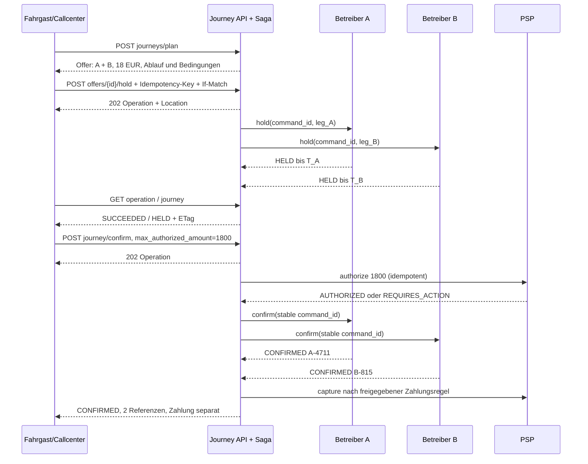

# 05 · API-Verträge und Integrationen

Status: technischer Entwurf 0.1, 25.10.2026. Die [OpenAPI-Datei](api/openapi.yaml) spezifiziert 14 Kernendpunkte und 42 Datenschemata. Sie ist ein überprüfbarer Vertragsentwurf, keine Behauptung implementierter APIs. Endpunkte weiterer Fachmodule werden unten mit den notwendigen Vertragsbedingungen beschrieben; ihre vollständigen OpenAPI-Schemata sind vor Implementierung zu ergänzen. Quellenanforderungen: INT-001–INT-015, FED-001–FED-028, SYS-005–SYS-007, SEC-001/005/008/016, NFR-012/017, CFG-001–CFG-022 sowie Lastenheft 8, M und O.

## 5.1 Einheitliche Konventionen

| Aspekt | Verbindlicher technischer Entwurf |
|---|---|
| Transport/Version | HTTPS, REST/JSON, UTF-8, `/v1`; OpenAPI 3.1. Breaking Changes benötigen neue Major-Version. Vorschlag: mindestens sechs Monate Parallelbetrieb nach angekündigter Ablösung; konkrete Partnerfristen vertraglich bestätigen. |
| Identitäten | UUID für öffentliche Ressourcen-IDs; interne Betreiber-IDs niemals als globale Personenkennung. OIDC Authorization Code + PKCE für Menschen; OAuth Client Credentials für eng berechtigte Adapter. Jede Anfrage prüft issuer, audience, expiry, session status und Scopes. |
| Mandant | Aktiver Tenant aus serverseitig verifizierter Mitgliedschaft/Tokenbindung. Ein Header, Pfad oder JSON-Feld darf keine zusätzlichen Rechte erzeugen. Jeder Objektzugriff prüft zusätzlich Dienst, Rolle und Zweck. Föderationsantworten sind freigegebene Projektionen, kein mandantenübergreifendes CRUD. |
| Minimierung | Personen- und Unterstützungsdaten nur an zuständige Buchungs-/Beförderungsrollen; keine Diagnosen, Kartendaten oder vollständigen Personalprofile in Journey/Events. Fahrer sehen ausschließlich aktuell zugeordnete Beförderungsaufgaben. |
| Zeit | RFC-3339-Zeitpunkte mit Offset; Datenbank UTC, zusätzlich IANA-Zeitzone für lokale Regeln. `desired_at` und `time_zone` müssen denselben lokalen Zeitpunkt beschreiben. DST-Lücken ablehnen, doppelte Ortszeit braucht eindeutigen Offset. Wunsch, Zusage, Prognose und tatsächliches Ereignis getrennt. |
| Geld | `{amount_minor:1800,currency:"EUR",exponent:2}`; integer zwischen −9.007.199.254.740.991 und +9.007.199.254.740.991 bei signierten Beträgen, sonst nichtnegativ. Negative Rabatt-/Korrekturkomponenten nur im dafür vorgesehenen SignedMoney-Typ. EUR-Exponent 2 serverseitig prüfen. Mengen, Sätze und Verteilungsschlüssel als exakte Dezimalstrings; kein binary float für Geld. |
| Nebenläufigkeit | GET liefert starken ETag `"7"`; mutierende Revisionseingriffe brauchen `If-Match: "7"`. Fehlender Header: 428; veraltete Revision: 412. Angebotsrevision, akzeptierte Terms und ETag müssen übereinstimmen. |
| Fehler | `application/problem+json`, stabiler `code`, `correlation_id`, optional Feldverletzungen mit JSON-Pointer. Keine Stacktraces und keine fremden Objektbezeichnungen. Nicht sichtbare Ressourcen ergeben konsistent 404; fehlender Funktionsscope 403. |
| Listen | `limit` 1–100 (Default 50), opaker signierter `cursor`, stabiler Sortierschlüssel `(created_at,id)` und Snapshot/As-of bei Exporten. Filter dürfen Autorisierung nur weiter einschränken. Antwort `{items,next_cursor,as_of}`. Vollständige Exportläufe sind asynchron. |
| Tracing/Rate Limit | W3C `traceparent`, neue interne Correlation-ID bei ungültigem Header; 429 mit Retry-After. Quoten nach Tenant, Partner und Akteur. Keine Personen-/Ortssuchen als Metriklabels. |

**Idempotenz:** Scope ist `(auth_principal, tenant_context, operation_name, Idempotency-Key)`. Der Server speichert kanonischen Request-Fingerprint einschließlich Ressourcen-ID und fachlich relevanter Header, Operations-ID, HTTP-Ergebnis und Zeit. Gleiches Kommando erhält dieselbe Ressourcen-/Operations-ID; gleicher Schlüssel mit anderem Fingerprint ergibt `409 IDEMPOTENCY_CONFLICT`. Prüfung des vorhandenen Idempotenzeintrags erfolgt nach Authentisierung, aber vor erneutem ETag-/Angebotsablauftest: Ein bereits erfolgreich angenommenes Kommando darf bei Wiederholung nicht nachträglich als abgelaufen erscheinen. Authentisierung und heutige Leseberechtigung werden trotzdem erneut geprüft.

Entwurfswert für die vollständige Response-Cachehaltung: 72 Stunden. Die dauerhafte Geschäftsbefehls-ID und Unique-Constraints für Buchung, Zahlung, Kostenbuchung und Event-Deduplikation bleiben für die freigegebene fachliche Aufbewahrungsdauer erhalten. Cacheablauf ist keine Erlaubnis, dieselbe Zahlung nochmals auszuführen. Bei `202`, Timeout oder Verbindungsabbruch fragt der Client die vorhandene Operation ab bzw. sendet exakt denselben Schlüssel erneut. Ein neuer Schlüssel ist nur für einen neuen, bewusst ausgelösten Vorgang zulässig. Zwei verschiedene Schlüssel auf derselben Offer-/Journey-Revision verhindern ETag, aktive Saga und fachliche Unique-Constraints.

## 5.2 Vertragsobjekte der Reisekette

`JourneyOffer` enthält geordnete `OfferLeg`s, Umstiege, einen unveränderlichen Preisstand, eine gemeinsame Ablaufzeit sowie den Hash der akzeptierten Bedingungen. Ein Angebot erzeugt noch keine Kapazitätszusage. `expires_at` ist das Minimum aus allen buchungsrelevanten Partnerfristen und eigener Angebotsfrist, abzüglich definierter Transport-/Uhrenreserve. Nicht buchungsrelevante Fahrplandaten haben zusätzlich ein Aktualitätsdatum im jeweiligen Adaptermodell.

Jedes Leg enthält Betreiber, gegebenenfalls Verkäufer-Rechtseinheit, Start/Ziel, Zeitplan, Zugänglichkeitsstatus, Tarifversion und eine klare Fähigkeit:

| `booking_capability` | Bedeutung und API-Regel |
|---|---|
| `PLATFORM_BOOKABLE` | Vertrag und technisch bestätigte Booking-/Status-/Storno-Fähigkeit vorhanden. Hold und Confirm nur durch zuständigen Betreiberadapter. Preis muss bekannt sein, einschließlich expliziter Null bei gültigem Zeitkartenanspruch. |
| `EXTERNAL_BOOKING` | Externer Buchungsweg mit geprüftem HTTPS-Ziel; keine interne Kapazitäts- oder Ticketbestätigung. Ein bekannter externer Preis ist informativ und wird nicht kassiert. |
| `INFORMATION_ONLY` | Verbindungsauskunft, Fußweg oder sonstiger nicht transaktionaler Abschnitt; kein interner Kauf. Bei Transport ohne zuverlässigen Tarif bleibt der Preis unbekannt. Fußweg verwendet `NOT_APPLICABLE`, nicht einen erfundenen Verkehrstarif. |

`price.pay_at_platform` umfasst ausschließlich im Checkout tatsächlich zu zahlende, plattformbuchbare Leistungen und ausdrücklich akzeptierte Gebühren. `external_known` enthält bekannte separat zu zahlende Beträge. `total_known_amount = pay_at_platform + external_known`; `external_unknown_leg_ids` nennt jedes verbleibende unbepreiste Transportleg. `is_complete_total` ist nur ohne solche Lücken wahr. Alle Beträge einer Checkout-Transaktion haben dieselbe Währung und denselben Exponenten; Währungswechsel wird zunächst als separater Kauf ausgewiesen. Die Oberfläche darf `total_known_amount` bei Lücken nicht als vollständigen Reisepreis beschriften.

`fare_components` erklärt den Endpreis. Komponenten werden als **disjunkte additive Preisbestandteile** geführt: z. B. Nettobeförderung + Nettoaufschlag − Nettorabatt + Steuer = Brutto. Steuer darf nicht zusätzlich auf bereits brutto ausgewiesene Komponenten addiert werden. Die Kundenzahlung und B2B-Provision sind getrennte Preis-/Ledgerkontexte; eine vom Betreiber getragene Provision ist keine zusätzliche Kundenkomponente. Preisregel, Zuschussfinanzierer und Steuerermittlung werden serverseitig referenziert.

Ein `Transfer` weist Gehzeit, gesamte Mindestwechselzeit, verfügbare Zeit und Barrierefreiheit aus. Mindestwechselzeit umfasst Gehzeit plus individuelle Ein-/Ausstiegs-/Orientierungspuffer und vertraglichen Sicherheitszuschlag; Gehzeit wird nicht nochmals addiert. `NOT_GUARANTEED` ist der Default. `CONTRACTUAL_PROTECTION` darf nur bei hinterlegter und wirksamer Anschlussregel verwendet werden.

## 5.3 Buchung zweier Betreiber – konkreter Ablauf



1. `POST /v1/federation/journeys/plan` protokolliert den Suchversuch. Kein Treffer ist `200` mit leeren `offers` und normiertem Ablehnungsgrund; ein fehlerhafter Eingabewert ist `422`. Ein einzelner Partner-Timeout wird in `partners` sichtbar, andere Reiseoptionen bleiben verfügbar. Planungsbudget: vorläufig 5 Sekunden gemäß Lastenheft, darunter partnerbezogene Deadlines mit Reserve.
2. `GET /v1/federation/offers/{offer_id}` liest genau den angebotenen Stand mit ETag. Keine Neuberechnung unter derselben ID/Revision.
3. `POST /v1/federation/offers/{offer_id}/hold` akzeptiert Revision/Terms und explizit quittierte externe Legs. Standard ist `partial_booking_consent=false`. `202` bestätigt nur den dauerhaften Auftrag. Die Operation erzeugt die Journey; ihre ID wird im Operationsergebnis geführt. Hold-Erfolg bedeutet alle erforderlichen lokalen Reservierungen vorhanden, nicht abgeschlossene Buchung. Spätestes Confirm-Zeitfenster richtet sich nach dem kürzesten Hold und dem verbleibenden Commit-Budget.
4. `POST /v1/federation/journeys/{journey_id}/confirm` bekommt den exakten maximal akzeptierten Plattformbetrag. Abweichung zum Offer ergibt `409 REQUOTE_REQUIRED`. PSP-Token bleibt ein PSP-Referenzwert; rohe Zahlungsdaten erreichen diese API nie. Zahlungs-SCA/3DS erzeugt `ACTION_REQUIRED` und eine kurzlebige PSP-Aktion. Erfolg des Browserredirects allein gilt nicht als Zahlung; die Saga wartet auf verifizierten PSP-Status. Holds werden nur innerhalb Partnerregeln verlängert; andernfalls erneutes Angebot und erforderlichenfalls Void.
5. `GET /v1/operations/{operation_id}` liefert den persistierten Fortschritt. `GET Journey` zeigt globale Zustände, Segmentzustände und Zahlung unabhängig. `CONFIRMED` darf erst gelten, wenn alle zur Plattformbuchung angenommenen Legs bestätigt sind und die vertragliche Zahlungsbedingung erfüllt ist. Bei externen Abschnitten bleibt `coverage=PLATFORM_SEGMENTS_ONLY`; die Oberfläche sagt „Plattformabschnitte bestätigt; externes Ticket erforderlich“.

Die Zahlungsregel hängt vom AG-Entscheid über Vermittlung, Verkäufer und PSP-Modell ab. Das Diagramm beschreibt den bevorzugten Ablauf für einen vertraglich zulässigen gemeinsamen Checkout. Eine Autorisierung ist keine Erfassung. Bei Capture-Fehler nach erfolgreichen Partnerbestätigungen wird die Reise als Zahlungsproblem bearbeitet und gemäß vereinbarter Regel kompensiert oder durch Operations geklärt; keine stille erfolgreiche Endmeldung. Eine versehentlich doppelte SCA-Rückkehr startet keine neue Autorisierung.

**Fehlerpfade:** Keine externen Transaktionen können durch eine lokale Datenbanktransaktion global atomar werden. Partner-Timeout nach Confirm bedeutet `UNKNOWN` am Leg und `RECONCILING` an Operation/Journey. Der Adapter fragt anhand stabiler Command-ID/Partnerreferenz den Partnerstatus ab. Erst ein nachgewiesenes Ergebnis erlaubt Bestätigung, Wiederholung eines nachweislich nicht ausgeführten Befehls oder Kompensation. Wiederholte Bestätigungen werden dedupliziert. Ein verspätetes positives Confirm nach begonnenem Abbruch erzeugt einen gezielten Stornoauftrag und wird nicht ignoriert. Kompensationsfehler führen zu sichtbarem `MANUAL_REVIEW` mit zuständigem Operator, Frist und Kundennachricht; `FAILED` darf nicht verschleiern, dass ein zahlungswirksames Segment weiter existiert.

`Operation.SUCCEEDED` gilt für den jeweiligen **Befehl**: bei Hold für Reservierung, bei Confirm für vollständige vereinbarte Bestätigung, bei Cancel für bestätigte Stornoaktionen und nachgewiesene Zahlungsreversierung entsprechend Zahlungsregel. Die Journey kann bereits `CANCELED` sein, während Zahlung `REFUNDED` noch nicht bestätigt ist; die Cancel-Operation bleibt dann offen. `Operation.FAILED` ist erst nach determiniertem Ergebnis möglich; ungelöste Fremdwirkungen bleiben `RECONCILING` oder `MANUAL_REVIEW`.

## 5.4 Storno, Teilstorno und Ausfall

`POST /journeys/{id}/cancellation-quotes` erhält konkrete `leg_ids` und Grund sowie den aktuellen Journey-ETag. Ergebnis: befristeter `CancellationQuote` mit Gebühr/Erstattung je Segment, unverändertem Regelstand und `remaining_journey_viable`. Die Quote bewirkt keine Stornierung. Bei Betreiber-/Sicherheitsausfall dürfen automatisch zulässige Schutzmaßnahmen greifen; die finanzielle Behandlung bleibt der vertraglichen Policy zugeordnet.

`POST /journeys/{id}/cancel` referenziert genau diese Quote. Der Server prüft Ablauf, Journey-Revision, die gültige Stornopolicy und die Zustimmung zum ggf. unbrauchbaren Rest. Nur die in der Quote genannten Legs werden storniert. Falls Partnerregeln oder Gebühren geändert wurden: `409 REQUOTE_REQUIRED` statt stiller Mehrbelastung. Bereits gefahrene Leistungen und offene Erstattungen bleiben sichtbar. Storno-/Refund-Ereignis und Korrekturbeleg referenzieren die Originalposition. Ein bereits geschlossener Finanzmonat wird nicht neu geschrieben.

| Fachfehler | HTTP/Code | Client-/Serverreaktion |
|---|---|---|
| Angebot/Hold abgelaufen | 409 `OFFER_EXPIRED` / `HOLD_EXPIRED` | Neu suchen; etwaige vorhandene Holds idempotent freigeben. |
| Preis/Terms verändert | 409 `REQUOTE_REQUIRED` | Neue Quote anzeigen und Zustimmung einholen. |
| Letzter Platz vergeben | 409 `CAPACITY_UNAVAILABLE` | Keine eigene Überbuchung; alternative Kette anbieten. |
| Auftrag bereits in Bearbeitung | 409 `OPERATION_IN_PROGRESS` | Bestehende Operation referenzieren, keinen zweiten Befehl erzeugen. |
| Partnerantwort unbestimmt | 202, Operation `RECONCILING` | Statusabgleich; keine automatische erneute Belastung. |
| Veraltete Revision | 412 `REVISION_MISMATCH` | Aktuelle Ressource lesen, Änderung erneut bewerten. |
| Fehlende Revision | 428 `PRECONDITION_REQUIRED` | Ressource vor Änderung lesen. |
| Verletzte Kooperation | 403 `COOPERATION_NOT_ALLOWED` | Keine neue Fremdbuchung; notwendige Abwicklung existierender Verträge nach Kapitel 02. |
| Fremdes Objekt | 404 `NOT_FOUND` | Keine Information über Existenz preisgeben. |
| Provider nicht erreichbar vor Annahme | 503 `PROVIDER_UNAVAILABLE` | Retry-After beachten; alle bereits persistierten Befehle weiter abfragen. |

## 5.5 Kosten, Belege, Konfiguration und Fahrerereignisse

| Kernendpunkt | Vertrag und Transaktionsgrenze |
|---|---|
| `POST /v1/cost-events/{id}/allocations` | Vollständige Allokationsrevision einer freigegebenen Kostenbasis. Kostenstelle/Kostenträger, Betrag, optionale exakte Menge/Einheit, Regelrevision und Begründung sind Pflicht. Summe aller Positionen entspricht exakt der allokierbaren Basis; Währung, Exponent, Tenant und Rechtseinheit passen. Geschlossene Periode oder bereits gebuchte Allokation: 409. Keine zusätzliche Quellkostenbuchung. Korrektur über Gegenbuchung/neue Revision, nicht Überschreiben. |
| `POST /v1/expenses/{id}/approve` | Exakte geprüfte Dokumentrevision, ETag und Begründung. OCR-Entwurf ist nie Buchungsgrundlage ohne Freigabe. Bei Schwellenüberschreitung `WAITING_SECOND_APPROVAL`; zweite berechtigte Person prüft neue Revision. `POSTED` erst nach atomarer Journal-/Outbox-Persistenz. Betrag/Dublette/Fremdfahrzeug/Originalhash prüfen. |
| `POST /v1/config/revisions/{id}/publish` | Publiziert bereits geprüfte Revision mit Wirkungsbericht und Wirksamkeitsbeginn. Konfiguration darf systemische Grenzen nicht aufheben; bestehende Zusageversionen bleiben gültig. Signierte Identität liefert Tenant. |
| `POST /v1/rosters/{id}/publish` | Prüft Personalkonflikte, Ruhezeit, Abwesenheit, Qualifikation, Ressourcen und Regeln. Versioniert veröffentlichen; Fahrerbenachrichtigung über Outbox. Eine Veröffentlichung erteilt noch keine fehlende technische Fahrzeugfreigabe. |
| `POST /v1/driver/events` | Stabile Event-ID, Schicht, Fahrzeug, Buchung, Stop und Planrevision. Offlinemeldung besitzt Ereignis-/Geräte-/Serverempfangszeit. Rückgabe `APPLIED`, `DUPLICATE` oder `REVIEW_REQUIRED`. Zuordnung und zulässigen Zustandsübergang serverseitig prüfen. Kein verspätetes Event hebt eine aktuelle Schadenssperre auf. |

Allokationen über Rechtsträgergrenzen werden **nicht** durch einen Schreibzugriff auf fremde Kostenstellen umgesetzt. Jede Seite erhält ihren eigenen vertraglich referenzierten Intercompany-Beleg bzw. Leistungsnachweis. Konsolidierungsreports eliminieren die gepaarten internen Verrechnungsposten; siehe [Kostenmodell](03-kosten-und-clearing.md). Die Allokations-API ist für eine einzelne autorisierte Buchhaltungssphäre definiert.

## 5.6 Partnerereignisse und Zustellgarantie

`POST /v1/federation/partners/{partner_id}/events` benutzt eine eigene Signaturauthentisierung. Beispielheader:

```text
X-Partner-Key-Id: key-2026-10
X-Partner-Timestamp: <Unix-Sekunden>
X-Partner-Signature: v1=<hex(HMAC-SHA256(secret, timestamp + "." + raw_body))>
```

TLS ist zusätzlich Pflicht. Key-ID verweist auf einen im Secret Manager verwalteten, rotierbaren Partnerschlüssel. Der Server prüft konstantzeitlich Signatur, maximale Körpergröße, Zeitfenster von ±300 Sekunden, Partnerbindung, zulässige Aussteller-tenant_id und Ereignistyp. Zeitabweichung wird beobachtet; keine Ausweitung des Replayfensters bei Uhrfehler. Der Body wird exakt signiert, nicht nach JSON-Reformatierung. Während kontrollierter Schlüsselrotation sind alter und neuer Schlüssel kurzzeitig verifizierbar.

Inbox-Unique-Key: `(partner_id,event_id)` plus Payloadhash. Identisches Duplikat: 200 `ALREADY_RECEIVED`; identische ID mit verändertem Payload: 409, Sicherheitsalarm und Quarantäne. Neues authentisches Event: 202 erst nach dauerhaftem Inbox-Commit. Fachverarbeitung und Zustandsübergang erfolgen mit Aggregatversion und Deduplikation; ältere Ereignisse überschreiben keinen neueren Zustand. Versionslücken lösen Statusabgleich aus. `tenant_id` im Event ist Metadatum und muss zur verifizierten Partnerbindung passen; es ist keine Autorisierungsquelle.

Zustellung ist mindestens einmal. Vorschlag für Outbound-Retry: 1 s, 5 s, 30 s, 2 min, 10 min, danach exponentiell mit Jitter bis 24 h; 429 respektiert Retry-After. Nach Erschöpfung Dead-Letter und Betreiberwarnung, kein stiller Verlust. Der Partner kann über freigegebene Statusabfragen nachziehen. Outbound-Projektionen haben Empfängerbindung und minimierten Payload. Provider-Adapter normalisieren fremde Sequenzmodelle; eine standardisierte Hülle behauptet keine vorhandene Partnerfähigkeit.

## 5.7 Ergänzender Endpunktkatalog und Realisierungspflichten

Die folgende Tabelle ist verbindlicher Funktionszuschnitt; Payloads, Filterschemata und Negativbeispiele müssen als zusätzliche OpenAPI-Artefakte umgesetzt werden. Die Kerndatei allein ist keine vollständige Spezifikation aller 672 Anforderungen.

| Modul | Weitere Endpunkte | Zu ergänzende Pflichtverträge |
|---|---|---|
| Identität/Konten | `/v1/me`, `/v1/passengers`, `/v1/delegations`, `/v1/privacy/requests` | Verifizierte Kontakte; Vertretungsberechtigung; gesperrte Sitzung; Auskunft/Löschung und Legal Hold. |
| Einbetreiber-/Serienbuchung | `/v1/ride-offers`, `/v1/bookings`, `/v1/booking-series` | Ein Segment verwendet denselben Tarif-/Kapazitätskern; Serienergebnis pro Datum, keine pauschale Zusage fehlgeschlagener Instanzen. |
| Dispatch/Leitstelle | `/v1/operator/vehicles`, `/v1/operator/incidents`, `/v1/runs/{id}/revisions` | Plan-CAS, Sicherheitsprüfung im Commit, Begründung manueller Änderung, Konfliktantwort und Planvergleich. |
| Fahrer/Check | `/v1/driver/shifts/{id}/run`, `/v1/inspections`, `/v1/inspections/{id}/submit` | Exakte Checkvorlage, unveränderliche Antworten, technische Einsatzfreigabe ausschließlich serverbestätigt. |
| Schäden/Werkstatt | `/v1/defects`, `/v1/defects/{id}/triage`, `/v1/repair-orders`, `/v1/vehicles/{id}/release` | Sperr-/Freigabeberechtigung, Evidenz, Vieraugenpflicht, qualifizierte Folgeprüfung, Kostenbezug. |
| Schicht/Arbeitszeit | `/v1/rosters`, `/v1/shift-offers`, `/v1/shift-swaps`, `/v1/time-events`, `/v1/time-corrections`, `/v1/absences` | Eigene vs Personalplaner-Sicht, atomarer Tausch, keine Abwesenheitsdiagnosen, nachvollziehbare Ist-Zeitkorrekturen. |
| Geodaten/Verkehrsprodukte | `/v1/services`, `/v1/service-areas`, `/v1/stops`, `/v1/transfer-hubs` | GeoJSON/SRID-Konvention, Datengültigkeit, sichere barrierefreie Zuordnung, Wirksamkeitsprüfung. |
| Partner intern | `/v1/partner/capabilities`, `/v1/partner/offers`, `/v1/partner/reservations`, `/v1/partner/reservations/{id}/confirm`, `/cancel`, `/status` | Hold-TTL, stabile Command-ID, Statusauflösung nach Timeout, Kompensationsfähigkeit, Zuordnung Partnervertrag und Datenprojektion. OpenAPI je Adapter plus Konformitätstests. |
| Zahlungsprovider | Adapterinterne Authorize/Capture/Void/Refund/Status, separater `/v1/payments/provider-events/{provider}` | PSP-spezifische Signatur statt generischem Partner-HMAC, SCA, Idempotenz, gesonderte Payment-Operationen, Settlement-Dateiabgleich. |
| Finanzen/Belege | `/v1/expenses/receipts`, `/extract`, `/v1/expenses/{id}`, `/v1/cost-events`, `/v1/vehicles/{id}/total-cost`, `/v1/ledger/exports`, `/v1/clearing/statements` | Uploadticket mit Größe/MIME/Hash, Malware-Quarantäne, immutable Original, XML-Führung, Dublettenprüfung, Kostenbasis/Steuerquote, periodischer Abgleich. |
| Reports/KPIs | `/v1/analytics/metrics`, `/v1/reports/jobs`, `/v1/reports/jobs/{id}` | Definition/Version, Filter, Datenstand, Vollständigkeit, gleiche Nenner, Empfängerrechte bei Export; keine identifizierbaren Föderationskleingruppen. |
| Konfiguration | `/v1/config/effective`, `/v1/config/revisions`, `/v1/config/revisions/{id}`, `/validate`, `/impact` | Werttyp/Einheit/Min-Max, Herkunft/Präzedenz, Wirksamkeit, Freigaben, Wirkungsbericht-ID, Rücknahme als neue Revision. |
| Kommunikation/Support | `/v1/notifications`, `/v1/support/cases`, `/v1/webhook-subscriptions` | Kanalzweck, Opt-in unabhängig von Betriebsnachricht, Zustellstatus, redigierte Fallhistorie, Ziel-URL-Prüfung gegen SSRF. |
| ETA/AI/Simulation | `/v1/eta/models/{id}/quality`, `/v1/eta/profiles/{id}/challenge`, `/v1/scenarios`, `/v1/scenarios/{id}/runs` | Modell-/Datenversion, Aggregatgüte und Datenschutzgates, isolierte Simulationsressourcen, Human Review; keine automatische personenbezogene Leistungsbewertung. |

## 5.8 Vertragsprüfungen vor Umsetzung/Abnahme

Die ausgelieferte YAML muss als OpenAPI 3.1 parsbar sein; alle `$ref` müssen auflösbar, `operationId`s eindeutig und Schema-Beispiele gemäß JSON Schema gültig sein. Zusätzlich sind semantische Contract-Tests erforderlich: zwei Betreiber/letzter Platz; abgelaufene Holds; SCA länger als Hold; Confirm-Timeout mit spät positivem Status; Storno unbekannt; 100 identische Webhooks; Manipulation tenant_id; unzulässige Fremd-ID; EUR-Rundungsrest; geschlossene Periode; Allokationssumme ≠ Basis; Offline-Check-in auf alter Planrevision. Solche Laufzeittests sind mangels Implementierung noch nicht ausgeführt. Die Dokument-/Schema-Prüfung wird getrennt davon ausgewiesen.

## 5.9 Ergänzte Zusage-, Vertretungs- und Ausführungsverträge

`PlanRequest.booking_subject` ist verpflichtend: SELF bindet den eingeloggten Fahrgast; DELEGATED bindet einen verifizierten Fahrgast und eine aktuell gültige Vertretungs-/Callcenter-Legitimation. Der Server prüft Zweck, Dienst und Laufzeit bei Planung, Hold und Confirm erneut. `entitlement_refs` referenziert serverseitig geprüfte Zeitkarten/Ermäßigungen, keine frei vorgegebenen Rabatte. Quote und Journey speichern die aufgelöste Person und Berechtigungsrevision; der Bediener bleibt als eigener Akteur im Audit. Ein Subjektwechsel erfordert neues Angebot.

`OfferLeg.pickup_window/arrival_window` beschreiben die angebotenen Zusagegrenzen, `JourneyLeg` die gebundene Version. Beide verwenden `TimeWindow {earliest_at,latest_at}`. Bookable-Angebote sowie bestätigte/abgeschlossene bookable JourneyLegs müssen nichtleere Fenster haben. Einzelne `planned_departure_at/planned_arrival_at` sind nominale Planzeiten, keine Ersatzdefinition des Fensters. Der Server prüft Chronologie und `arrival_latest(A) + minimum_transfer_seconds <= departure_earliest(B)`. `minimum_transfer_seconds` enthält den gesamten Geh-/Assistenz-/Sicherheitspuffer; dieser wird nicht doppelt addiert.

Journey und Leg führen zusätzlich `execution_state`. `transfer_risks` liefert laufende Anschlussrisiken und die Restreserve nach kompletter Mindestwechselzeit, auch negative Werte. Ausführung und Vertrag bleiben getrennt: ein gestörter Anschluss löscht keine historische Bestätigung. `CANCEL_PENDING` zeigt laufenden Storno, `Operation.MANUAL_REVIEW` einen Klärfall. Das Zahlungsfeld ist eine UI-Projektion: interne CAPTURE_UNKNOWN/RECONCILING → UNKNOWN, REFUND_PENDING → bisheriger Capture-/Refundstand plus laufende Cancel-/Reconcile-Operation, deren Fortschritt zwingend angezeigt wird.

Kostenallokationen und ihre Basis verwenden `SignedMoney`, damit Gegenereignisse die ursprünglichen Teilbeträge exakt negativ umkehren können. Korrekturen brauchen eigenes autorisiertes Gegenereignis und dürfen keine bestehenden POSTED-Zeilen verändern.
