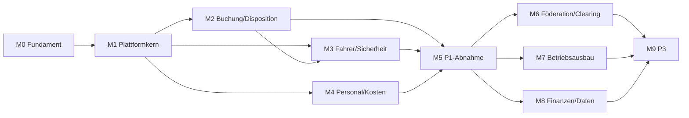

# Umsetzungsplan TAKTOVIA

**Version 0.1 · Planungsentwurf · 10. November 2026**

Grundlage: [Pflichtenheft V0.1](pflichtenheft.md) vom 25.10.2026 mit seinen Anhängen. Dieser Plan beschreibt, in welcher Reihenfolge und mit welchen Nachweisen alle 672 Anforderungen umgesetzt werden. Er ändert weder Phasen noch Prioritäten des Lastenhefts. Im Repository liegt bisher ausschließlich Dokumentation; es existiert noch kein Anwendungscode.

Die Meilensteine sind in 810 einzeln abnehmbare Arbeitspakete (WPs) gegliedert, dokumentiert je Planungseinheit unter [umsetzungsplan/wp/](umsetzungsplan/wp/README.md). Jede Anforderung ist in [umsetzungsplan/arbeitspakete.csv](umsetzungsplan/arbeitspakete.csv) genau einem WP zugeordnet. [check_wp.py](umsetzungsplan/check_wp.py) prüft die Vollständigkeit und erzeugt diese Datei. Abschnitt 10 beschreibt Aufbau, Prüfumfang und Befunde der Feinplanung.

## 1. Überblick

Die Umsetzung gliedert sich in zehn Meilensteine. M0–M5 liefern Phase 1 (Einbetreiber-Pilot, 202 MUSS), M6–M8 Phase 2 (Föderation, Betriebsausbau, Finanzen/Daten, 398 Anforderungen), M9 Phase 3 (72 Anforderungen).

| MS | Inhalt | Phase | Anforderungen | MUSS / SOLL / KANN | Lastenheft-Module |
|---|---|---|---:|---:|---|
| M0 | Fundament, Spikes, Detailvertragsprozess | – | – | – | Voraussetzung für alle |
| M1 | Plattformkern: Mandanten, Identität, Konfiguration, Ereignisse | P1 | 46 | 46 / 0 / 0 | SYS 7, IAM 8, SEC 13, MUL 7, CFG 7, INT 4 |
| M2 | Einbetreiber-Buchung und Disposition | P1 | 38 | 38 / 0 / 0 | PAX 9, BKG 8, OPT 11, GEO 3, PAY 4, COM(6.12) 3 |
| M3 | Fahrer, Leitstelle, Fahrzeugsicherheit | P1 | 48 | 48 / 0 / 0 | DRV 8, OPS 6, FLT 4, CHK 16, DMG 12, AUT 2 |
| M4 | Personal, Zeit, Belege, Kosten, Kennzahlen | P1 | 53 | 53 / 0 / 0 | SCH 10, TIM 6, DOC 13, FCO 5, KPI 14, ANA 3, ETA 2 |
| M5 | P1-Härtung und Pilotabnahme | P1 | 17 | 17 / 0 / 0 | NFR 11, QAT 6 |
| M6 | Föderation, gemeinsamer Checkout, Clearing | P2 | 89 | 64 / 25 / 0 | FED 29, MUL 16, PAY 12, PTI 11, COM(I.9) 11, INT 10 |
| M7 | Betriebsausbau: Fahrgast, Leitstelle, Fahrer, Personal | P2 | 156 | 83 / 73 / 0 | SCH 26, DMG 15, CHK 13, TIM 13, DRV 11, OPS 11, BKG 10, SUP 10, AST 10, COM(6.12) 9, OPT 8, GEO 8, PAX 7, FLT 5 |
| M8 | Finanzen, Controlling, ETA, Governance | P2 | 153 | 116 / 37 / 0 | ETA 23, KPI 19, FCO 17, DOC 16, CFG 15, AUT 12, GOV 11, ANA 9, SEC 9, NFR 8, IAM 5, QAT 5, SYS 4 |
| M9 | Prognose, Simulation, P3-Ergänzungen | P3 | 72 | 9 / 46 / 17 | AI 9, SIM 9 und 54 Einzelanforderungen aus 31 weiteren Modulen |
| | **Summe** | | **672** | **474 / 181 / 17** | |



M2, M3 und M4 laufen nach M1 weitgehend parallel; M3 braucht aus M2 nur den Fahrtenplan (`vehicle_run`, Stoppliste). M6, M7 und M8 sind voneinander unabhängige P2-Ströme.

## 2. Verbindliche Leitlinien aus dem Pflichtenheft

Diese Regeln gelten ab dem ersten Commit und werden in CI geprüft, nicht erst zur Abnahme.

1. **Modularer Kern statt Microservices** (Kap. 01 §1.1): ein Kotlin/Spring-Deployable mit expliziten Modul-APIs; getrennte Python-Worker nur für Routing/Optimierung und Dokumente. Modulgrenzen werden per Architekturtest erzwungen: ein Modul schreibt nur eigene Tabellen.
2. **Mandantenisolation in jeder Schicht** (Kap. 02 §4, Kap. 04 §4.6): Primärschlüssel `(tenant_id,id)`, zusammengesetzte FKs, RLS, Tenantkontext nur transaktionslokal per `set_config(..., true)`. Die Laufzeitrolle hat weder Superuser noch BYPASSRLS noch Tabelleneigentum. Alle Integrationstests laufen unter dieser Rolle.
3. **Einmalige Geschäftswirkung** (Kap. 01 §1.5): Aggregat, Revision und Outbox in einer Transaktion; Inbox-Deduplikation; Idempotenzschlüssel je Mandant, Akteur und Operationstyp. PSP- und Partneraufrufe nie innerhalb offener SQL-Transaktionen.
4. **Kapazität nur in PostgreSQL** (Kap. 01 §1.4): Hold und Confirm sperren Kapazitätsabschnitte in stabiler Reihenfolge. Redis ist ausschließlich Cache und Rate-Limit.
5. **Geld ohne Gleitkomma** (Kap. 03 §2.1): `bigint` in kleinster Einheit, Largest-Remainder-Umlage, Journal je Rechtsträger und Währung ausgeglichen, Korrektur nur durch Gegenereignis.
6. **Unbestimmtes bleibt unbestimmt** (Kap. 02 §7.3–7.4): `UNKNOWN`/`RECONCILING` werden nie zu Erfolg oder Fehler verkürzt; Timeouts lösen Abgleich aus, keine Neubuchung.
7. **Vertrag vor Code** (Kap. 08 §8.4): Vor Umsetzung einer MUSS-Anforderung sind Verantwortlicher, Detailvertrag (OpenAPI/DDL/Zustandsautomat) und mindestens ein positiver ausführbarer Test verknüpft. Jedes WP nennt dafür unter „Detailverträge vorab“ und „Tests“, was vorliegen muss.

## 3. Zielstruktur des Repositorys

```
backend/                  Kotlin, Java 21, Spring Boot, Gradle-Multiprojekt
  platform/               Tenantkontext, RLS-Anbindung, Outbox/Inbox, Idempotenz, Audit, Geld-/Zeittypen
  modules/<modul>/        identity, config, service-geo, booking-dispatch, journey-federation,
                          fare-payment, fleet-safety, staff-time, documents-finance,
                          communication-support, analytics
  app/                    Zusammenbau, API-Gateway/BFF, Security-Konfiguration
  adapters/               psp, partner-tomp, partner-osdm, timetable-gtfs, erp-export, ocr, notification
db/migrations/            Flyway; Ausgangspunkt docs/pflichtenheft/schema/kernschema.sql
api/                      OpenAPI 3.1 je Modul; Ausgangspunkt docs/pflichtenheft/api/openapi.yaml
workers/routing/          Python, OR-Tools, Valhalla-Adapter
workers/documents/        OCR-Adapter, Malware-Scan, KoSIT-Validator
web/                      TypeScript/React-Monorepo: design-system, passenger, operator (inkl. Callcenter, Finanzen, Personal, Admin)
mobile/driver/            Flutter, verschlüsselte SQLite-Outbox
mobile/passenger/         Flutter (ab M7)
infra/                    docker-compose für lokale Entwicklung, IaC, Observability
tests/acceptance/         AT-/E2E-/PH-AT-Szenarien, Sandbox-Partner, PSP-Simulator
tests/performance/        Lastprofile, Restore-Drehbuch
```

## 4. Meilensteine im Detail

Jeder Meilenstein endet mit einem Gate: alle zugeordneten MUSS-Anforderungen haben einen grünen Test, und die genannten Referenztests sind mit Build, Evidenz und Entscheidung in `e2e.csv` eingetragen. Die Zuordnung der 106 Originaltests zu Meilensteinen ist ein Vorschlag dieses Plans und wird in M0 mit dem Auftraggeber bestätigt.

### M0 – Fundament und Spikes

Ziel: Das Team kann vertragsgetrieben liefern, und die vier technischen Hauptrisiken sind gemessen statt angenommen.

- Repository-Gerüst, Build, CI mit Vertragsprüfung (`validate_artifacts.py` als Pflichtschritt), SBOM, Lockfiles, signierte Images.
- Lokale Umgebung per `docker-compose`: PostgreSQL 17/PostGIS, RabbitMQ, Redis, Keycloak, MinIO, Valhalla.
- Kernschema als erste Flyway-Migration lauffähig machen und gegen eine echte Datenbank testen. Der Prüfbericht (Kap. 09) weist ausdrücklich aus, dass SQL, RLS und Trigger bisher nur geparst, nie ausgeführt wurden.
- Getrennte DB-Rollen (Migrator, Runtime, Modulzugänge) und Testharness, die den Tenantkontext nach Pool-Wiederverwendung prüft.
- **Spikes** (Kap. 01 §1.1): (a) Hold/Confirm unter 100 parallelen Transaktionen auf PostGIS, (b) Solverlaufzeit für Einfügeheuristik innerhalb 1 s, (c) Driver-Offline-Queue auf Zielgeräten, (d) PSP-Sandbox für Authorize/Capture/Void/Refund/Status. Dazu der streckenbezogene Routingvergleich aus D-09.
- Deterministische Sandbox-Partner und PSP-Simulator mit steuerbaren Fehlern (Timeout, verlorene Antwort, Duplikat) als Testinfrastruktur.
- Detailvertragsprozess: Vorlage je Anforderung, Review-Rollen, Pflege von `arbeitspakete.csv`.

Gate: Kernschema migriert auf leerer Datenbank; Spike-Berichte mit Messwerten; Entscheidung über Routinganbieter und PSP-Kandidat vorbereitet.

### M1 – Plattformkern (46 MUSS)

- Mandant, Organisation, Rechtsträger, Mitgliedschaft; serverseitiger Tenantwechsel; OIDC mit MFA und PKCE; Rollen- und Objektberechtigung; Sitzungssperre.
- RLS für alle Tabellen, Feldschutz für PII/HR/Finanzen, Audit append-only, Sicherheitsereignisse ohne Fremdinhalte.
- Konfigurationsregister mit Präzedenzkette, Wirksamkeitsintervallen, Vier-Augen-Freigabe, Rollback als neue Revision; Schemas für die P1-relevanten der 80 Parameter.
- Outbox-Relay, Inbox, Idempotenzregister, `operation`-Ressource mit Lease/Fencing, einheitliches Fehlermodell (Kap. 05 §5.1).
- Endpunkte: `/v1/me`, `/v1/config/*`, `/v1/operations/{id}`, Webhook-Grundlage.
- Web: Designsystem, Anmeldung, Mandantenwechsel, Admin-Grundgerüst (UI-17/18 Basis, UI-20 Basis).

Gate: PH-AT-001, PH-AT-011, PH-AT-017, PH-AT-018; AT-18, AT-24, AT-49, E2E-091, E2E-096 bis 098.

### M2 – Einbetreiber-Buchung und Disposition (38 MUSS)

- Dienste, Bediengebiete, Haltepunktrevisionen mit Geo-Validierung.
- Angebotsbildung: Einfügeheuristik mit Ressourcenvektor (Sitz, Rollstuhl, Ausstattung), harten Zeitfenstern, `travel_attempt` für die Ablehnungsstatistik.
- Hold, Confirm, Ablauf und Storno im lokalen Betreiberkern; Tarifrevision und unveränderlicher `fare_quote`.
- Zahlung über PSP-Adapter mit eigenem Zahlungsautomaten (ein Betreiber, ein Zahlungsempfänger).
- Betriebsnachrichten (Push/SMS/E-Mail) mit Zustellversuchen.
- Passenger-Web als PWA: UI-01 bis UI-05.
- Endpunkte: `/v1/ride-offers`, `/v1/bookings`, `/v1/services`, `/v1/service-areas`, `/v1/stops`, `/v1/payments/provider-events/{provider}`.

Gate: PH-AT-004; AT-01 bis AT-05, AT-07, AT-13, AT-15, AT-19. AT-01 und AT-13 sind in M2 nur teilweise nachweisbar, siehe Abschnitt 10.3.

### M3 – Fahrer, Leitstelle, Fahrzeugsicherheit (48 MUSS)

- Driver-App (Flutter): Dienststart, Stoppliste, Check-in/out, Navigation, Offline-Queue mit `device_event_id`.
- Pflichtcheck mit versionierten Vorlagen; kritisches Nein sperrt synchron; Einsatzfreigabe ausschließlich serverbestätigt.
- Schadenmeldung mit Evidenz, Triage, Sperre und Wiederfreigabe mit Rollenprüfung.
- Fahrzeug- und Fahrerstamm, Qualifikationen, `resource_release`.
- Leitstelle: Livekarte mit Standortalter, Arbeitsliste, manuelle Umplanung mit Begründung und Plan-CAS; Störungsablauf bei Fahrzeugausfall.
- Grundlegende Alarme (AUT P1).
- UI-07, UI-09, UI-10, UI-11.

Gate: PH-AT-020; AT-08 bis AT-11, AT-26 bis AT-36, AT-50, AT-51, AT-60.

### M4 – Personal, Zeit, Belege, Kosten, Kennzahlen (53 MUSS)

- Dienstplan mit Entwurf/Publikation, Konfliktprüfung (Qualifikation, Doppelschicht, Ruhezeit); Zeiterfassung mit Plan/Ist-Trennung und DST-fester Rechnung; Abwesenheiten ohne Diagnosen.
- Belegupload mit Uploadticket, Quarantäne, Hash und unveränderlichem Original; OCR als Vorschlag; Dublettenprüfung; Vier-Augen-Freigabe.
- Kostenereignis, Journal, Fiskalperiode, Umlage mit Largest Remainder; ERP-Export als wiederholsicherer Job.
- Kennzahlregister mit Definitionsversion, Nenner, Datenstand und Vollständigkeit für die P1-KPIs; Nachfragetrichter aus `travel_attempt`.
- ETA-Grundmodell ohne Fahrerprofil (D-10-Favorit).
- UI-12 bis UI-15.

Gate: PH-AT-012, PH-AT-013, PH-AT-015, PH-AT-019, PH-AT-021; AT-37, AT-39 bis AT-41, AT-45, AT-47, AT-48, E2E-064 bis 068, E2E-072, E2E-073, E2E-080 bis 084.

### M5 – P1-Härtung und Pilotabnahme (17 MUSS)

- Lasttest gegen die Referenzlast mit mindestens zwei Mandanten; Messung der p95-Ziele bis zur Clientdarstellung.
- Restore-Übung mit RPO/RTO-Messung einschließlich PSP-Abgleich; Fault-Injection für Datenbank, Worker, Cache, PSP, Kartenquelle, Messaging.
- Penetrationstest, RLS-/Feldzugriffsprüfung, Barrierefreiheitsprüfung der Kernreisen mit Tastatur und Screenreader.
- Betriebshandbuch, Monitoring, Eskalation, Notbetrieb, Abbruchkriterien und Rückfallbetrieb für den Pilot.
- Nachweisführung: alle 202 P1-Anforderungen mit Test und Evidenz verknüpft.

Gate: alle sieben Gates aus Kap. 08 §8.4; AT-23, AT-25, AT-53, AT-54, AT-59, AT-61. Keine offenen Mängel der Klasse A.

### M6 – Föderation, gemeinsamer Checkout, Clearing (89: 64 MUSS, 25 SOLL)

- Kooperationsvertrag, Grants, Pause und Widerruf mit Auslaufregeln; minimierte Projektionen statt Fremdtabellenzugriff.
- Journey-Orchestrator als persistente Saga mit allen Statusdimensionen aus Kap. 02 §7.3 und dem Fehlervertrag aus §7.4; Reconciliation mit Backoff und Leitstellenalarm.
- Alle 14 Kernpfade der vorhandenen OpenAPI; interner Partnervertrag `/v1/partner/*`; Capability Registry.
- Adapter: interner Zweitbetreiber, TOMP, OSDM soweit Pilotpartner buchbar; GTFS/GTFS-RT für Informationssegmente; Anschlussüberwachung.
- Mehrparteien-Checkout, Guthaben und Gutscheine, Teilstorno, Refund-Obergrenzen; Settlement-Statements, Abgleich, Rückforderung statt negativer Auszahlung.
- UI-08, UI-16, UI-18; kombinierte Angebote und Checkout mit Betreiberausweis in UI-02/03.

Gate: PH-AT-002, PH-AT-003, PH-AT-005 bis PH-AT-010, PH-AT-014, PH-AT-016; AT-14, AT-16, E2E-085 bis 090, E2E-092 bis 095, E2E-104. Jede Partnerfähigkeit bleibt deaktiviert, bis ihr Sandbox-Nachweis vorliegt.

### M7 – Betriebsausbau (156: 83 MUSS, 73 SOLL)

Zwei parallele Ströme:

- **Fahrgast und Leitstelle** (63): Serien- und Gruppenbuchung, Callcenter mit Vertretungsprüfung (UI-06), Supportfälle, Massenkommunikation mit Zielgruppen, erweiterte Disposition, Gebiets- und Straßenrestriktionen, native Passenger-App.
- **Fahrer, Flotte, Personal** (93): Schichtangebote, Bewerbung und atomarer Tausch, Vorlagen, Urlaub und Zeitkonten, Zeitkorrekturen, Werkstattaufträge, Bekanntschäden, Prüfversionen, Fahrzeugwechsel, Inventar und Betriebshöfe.

Gate: AT-06, AT-12, AT-17, AT-38, AT-42 bis AT-44, AT-46, AT-52, AT-56, AT-57, AT-62, AT-63, E2E-069, E2E-071, E2E-100.

### M8 – Finanzen, Controlling, ETA, Governance (153: 116 MUSS, 37 SOLL)

Drei parallele Ströme:

- **Finanzen** (33): Eingangsrechnungen mit XRechnung/KoSIT, Tankkartenimport, TCO je Fahrzeug, Budgets, Deckungsbeitrag, Periodenabschluss mit Restatement-Ansicht.
- **Daten und Steuerung** (89): vollständiger KPI-Katalog (48 Definitionen ausführbar), Berichtsjobs, Mobilitätsdatenexport, restliche Parameter und Wirkungsbericht, Automatisierungsregeln und Alarme, lernfähige ETA mit Freigabegates und Fallback, Governance und Modellfreigabe.
- **Plattform** (31): erweiterte IAM-/SEC-/NFR-/QAT-Anforderungen, Lösch- und Auskunftsjobs, Legal Hold.

Gate: PH-AT-022; E2E-070, E2E-074 bis 079, E2E-099, E2E-101 bis 103, E2E-105, E2E-106.

### M9 – Phase 3 (72: 9 MUSS, 46 SOLL, 17 KANN)

- Nachfrageprognose mit Model Registry und Monitoring; Szenariosimulation mit eigenen Daten, Workern, Queue und Ressourcenlimits.
- E-Mobilität (Ladefenster, Reichweitenkonflikt) und die 54 verstreuten P3-Einzelanforderungen, je Modul gebündelt.
- KANN-Funktionen nur nach ausdrücklicher Aufnahme ins Release.

Gate: AT-20 bis AT-22, AT-55, AT-58.

## 5. Entscheidungen des Auftraggebers

Kein Entscheid blockiert M0–M2. Später blockieren sie konkrete Meilensteine; ohne Beschluss wird mit dem Favoriten aus Kap. 07 in der Sandbox gebaut, aber nicht produktiv aktiviert.

| Entscheidung | Benötigt bis Beginn | Wirkung bei Verzug |
|---|---|---|
| D-12 Budget, Team, Termin, Vorziehungen | M0 | Plan bleibt ohne Termine |
| D-02 Isolationsstufe | M1 | RLS-Default; spätere Datenbank je Mandant wäre Umbau |
| D-05 Pilotbetreiber, Region, Peaklast, Hosting | M2 (Fixtures), M5 (Lastprofil) | Lasttest ohne belastbares Profil |
| D-09 Routing, Karten, Telematik | M2 | Valhalla/OSM als Arbeitsstand |
| D-03 (Teil) PSP-Auswahl für Einbetreiberzahlung | M2 | Nur PSP-Simulator |
| D-11 Aufbewahrung, Löschfristen, Notbetrieb | M3 (Notbetrieb), M5 (Löschmatrix) | Keine Produktivfreigabe personenbezogener Daten |
| D-06, D-07 ERP, Kontenrahmen, Kostenregeln | M4 | Testkontenrahmen; Export nicht abnehmbar |
| D-10 Fahrerdaten, Mitbestimmung | M4 (Grundmodell), M8 (Personalisierung) | Personalisierung bleibt aus |
| D-01, D-03, D-04 Rollen, Geldfluss, Anschlussrisiko | M6 | Föderation nur in Sandbox |
| D-08 Partnerstandards, Buchungsrechte | M6 | Nur interner Zweitbetreiber-Adapter |

## 6. Qualitätssicherung

- **Testpyramide:** Unit-Tests für Domänenregeln; Integrationstests gegen echtes PostgreSQL unter der Runtime-Rolle (Testcontainers); API-Contract-Tests gegen die OpenAPI-Dateien; Akzeptanzszenarien in `tests/acceptance`.
- **Pflicht-Negativtests:** Jede Invariante aus Kap. 04 §4.5 erhält einen Test mit mindestens zwei parallelen Transaktionen. Die zwölf semantischen Contract-Fälle aus Kap. 05 §5.8 sind CI-Pflicht ab dem Meilenstein, der die betroffene Funktion liefert.
- **Nachverfolgung:** `check_wp.py` läuft als CI-Pflichtschritt. Ein WP gilt erst als umgesetzt, wenn die unter „Tests“ genannten Fälle grün sind. `e2e.csv` wird ausschließlich aus Testläufen mit Build-ID befüllt.
- **Mangelklassen** nach Lastenheft §11.3: Klasse A blockiert jedes Gate.

## 7. Risiken

| Risiko | Gegenmaßnahme |
|---|---|
| 202 P1-MUSS sind kein kleiner Pilot; Erwartung einer schnellen Demo | Umfang in M0 mit dem Auftraggeber bestätigen; Vorziehungen und Streichungen nur per D-12-Beschluss |
| Kernschema und Trigger sind nie ausgeführt worden | Erste Aufgabe in M0; Abweichungen fließen als Korrektur ins Pflichtenheft zurück |
| Detailverträge fehlen für die meisten der 672 Anforderungen | Vertragsarbeit läuft je Meilenstein einen Sprint voraus; dafür ist eigene Kapazität eingeplant |
| Solverlaufzeit und Kapazitätssperren unter Last | Spikes in M0; Lasttest bereits ab M2 fortlaufend, nicht erst in M5 |
| Reale Partner können weniger als die Sandbox (kein Hold, kein Status) | Capability Registry; solche Segmente bleiben `INFORMATION_ONLY` oder `EXTERNAL_REQUIRED` |
| Geschäftsentscheidungen D-01/D-03/D-04 verzögern sich | M6 ist bis zur Sandbox-Abnahme unabhängig lieferbar; Produktivschaltung getrennt |
| Mitbestimmung und Datenschutz bei Fahrerdaten | Grundmodell ohne Profil; Personalisierung ist ein Schalter mit Freigabegate |
| Doppelte IDs COM-001 bis 012 | Durchgängig `source_key`; Arbeitspakete aus I.9 tragen das Suffix `-CLR` |

## 8. Team und Zeitrahmen (Planungsannahme)

Budget, Teamgröße und Termine sind laut D-12 offen. Die folgenden Zahlen sind eine grobe Erstschätzung dieses Plans und nicht aus dem Pflichtenheft abgeleitet. Sie müssen nach den M0-Spikes neu bewertet werden.

Angenommene Besetzung: vier Fachteams (Plattform, Buchung/Disposition, Betrieb/Mobil, Finanzen/Daten) mit zusammen etwa 16 bis 20 Personen einschließlich QA, UX, DevOps und Fachanalyse.

| Abschnitt | Dauer | Bemerkung |
|---|---|---|
| M0 | 6–8 Wochen | Teamaufbau parallel |
| M1 | 10–12 Wochen | Alle Teams arbeiten am Kern mit |
| M2, M3, M4 | 5–6 Monate | Parallel; M3 startet nach dem ersten Fahrtenplan aus M2 |
| M5 | 8–10 Wochen | Danach Pilotbetrieb |
| **Phase 1 gesamt** | **etwa 12–14 Monate** | |
| M6, M7, M8 | 12–15 Monate | Parallel, gestaffelte Teilreleases |
| M9 | 6–8 Monate | Braucht Betriebsdaten aus dem Pilot |

## 9. Nächste Schritte

1. Diesen Plan und die Meilensteinzuordnung mit dem Auftraggeber abstimmen; D-12 und D-05 terminieren.
2. M0 beginnen: Repository-Gerüst, CI, lokale Umgebung, Kernschema als ausführbare Migration.
3. Offene Punkte der Einheiten M0 und M1 mit dem Auftraggeber klären und die Detailverträge für M1 erstellen (46 Anforderungen, 47 WPs).
4. Spikes durchführen und Schätzung aus Abschnitt 8 aktualisieren.

## 10. Feinplanung in Arbeitspakete

### 10.1 Aufbau

Jede der 20 Planungseinheiten hat eine Datei unter `umsetzungsplan/wp/`. Die großen Meilensteine M6 bis M9 sind dafür in Einheiten nach Fachstrom geteilt (M6a–c, M7a–d, M8a–e, M9a–b). Der [Index](umsetzungsplan/wp/README.md) nennt je Einheit Anzahl, Größenverteilung und offene Punkte.

Ein WP ist eine vertikal geschnittene Lieferung von höchstens sechs Personenwochen (S bis 1, M bis 3, L bis 6). Jedes WP nennt:

- Ziel und zugeordnete Anforderungen (`source_key`)
- Liefergegenstände mit konkreten Tabellen, Endpunkten, Bildschirmen, Parametern und Kennzahlen
- Detailverträge, die vor Codebeginn vorliegen müssen
- Akzeptanzkriterien, mindestens eines je Anforderung aus deren Originalabnahme
- Tests (positiv, negativ, bei Geld, Kapazität, Sicherheit und Datentrennung auch konkurrierend) und die bedienten Referenztests
- Bauabhängigkeiten auf andere WPs
- „Vollabnahme erst mit“: spätere WPs, ohne die die Originalabnahme nicht vollständig nachweisbar ist. Das ist keine Bauabhängigkeit.
- betroffene Auftraggeberentscheidungen, Größe und Abgrenzung

| | Anzahl |
|---|---:|
| Arbeitspakete | 810 |
| davon mit Anforderungen / reine Enabler | 632 / 178 |
| Größe S / M / L | 124 / 645 / 41 |
| Phase 1 (M0–M5) | 283 |
| Phase 2 (M6–M8) | 446 |
| Phase 3 (M9) | 81 |

Die Größenklassen sind Obergrenzen. Für Phase 1 ergeben sie zusammen höchstens rund 750 Personenwochen; das liegt in der Größenordnung der Planungsannahme aus Abschnitt 8 und ersetzt keine Schätzung je WP.

### 10.2 Maschinell geprüft

`python docs/umsetzungsplan/check_wp.py` endet nur fehlerfrei, wenn

- jede der 672 Anforderungen in genau einem WP steht und kein unbekannter Schlüssel vorkommt,
- jedes WP alle Pflichtfelder und eine Größe S, M oder L hat,
- jede Bauabhängigkeit auf ein existierendes WP zeigt, kein WP von einem späteren Meilenstein abhängt und kein Zyklus besteht.

Zusätzlich berichtet das Skript, ob jeder der folgenden Katalogeinträge in mindestens einem WP genannt wird. Stand dieses Dokuments: alle vollständig.

- 106 Originaltests und 22 PH-AT-Tests
- 80 Parameter und 48 Kennzahlen
- 38 Kerntabellen und die Ergänzungstabellen aus Kap. 04 §4.4
- 14 OpenAPI-Pfade und der Endpunktkatalog aus Kap. 05 §5.7
- die Bildschirme UI-01 bis UI-20

Die Prüfung weist nach, dass nichts aus diesen Katalogen unzugeordnet ist. Ob ein WP seine Anforderung fachlich vollständig trifft, hat je Einheit ein zweiter, unabhängiger Durchgang gegen Originalbeschreibung und Originalabnahme geprüft; eine Abnahme durch Fachverantwortliche ersetzt das nicht.

### 10.3 Befunde, die den Plan betreffen

- **Viele P1-Abnahmen brauchen spätere Lieferungen.** 72 WPs tragen „Vollabnahme erst mit“. Rund 20 der 46 M1-Anforderungen sind in M1 nur am Plattformbaustein nachweisbar, weil ihre Originalabnahme Buchung, Fahrzeug oder Zahlung voraussetzt. Der Auftraggeber muss festlegen, ob das am M1-Gate genügt oder die Endabnahme am späteren Gate nachgezogen wird.
- **AT-13 (Parallelfahrtenverbot) ist im M2-Gate nicht vollständig erfüllbar.** Die Regel steht in P2-Anforderungen und braucht ÖPNV-Daten aus M6. M2 weist nur die Ablehnung einer per Regel gesperrten Relation nach; der Rest folgt mit WP-M6a-26, WP-M6a-29 und WP-M7a-30.
- **AT-01 endet in M2 bei der bestätigten Buchung.** Fahrerzuweisung, Check-in und Fahrtende liefert M3.
- **Onlinezahlung ist laut Lastenheft P2** (`LH-6.10-PAY-005`), der Plan legt PSP-Adapter und AT-15 aber in M2. Die zugehörigen WPs sind dort Enabler ohne eigene Anforderung. Das braucht eine Bestätigung nach D-12.
- **Boarding-Code:** Der Fahrer-Check-in mit Code ist P1 (M3), die Anzeige des Codes beim Fahrgast P2 (WP-M7a-14). Der Übergabeweg im Pilot ist offen.
- **Alarmkanal vorgezogen:** Dead-Letter- und Sicherheitsalarme in M1 brauchen einen Zustellweg vor M5; dafür wurde WP-M1-47 ergänzt.
- **Suchindex:** Das Pflichtenheft nennt ihn als Isolations- und Löschziel, aber nicht als Baustein. Kein WP baut einen; ob einer gewünscht ist, muss geklärt werden.
- **Zuschüsse und Konzernrolle:** Pauschale Zuschussbuchungen je Vertrag und der Umfang einer Konzernadmin-Rolle sind im Pflichtenheft nicht festgelegt.

Darüber hinaus führen die WP-Dateien zusammen 711 offene Punkte, überwiegend fehlende Detailangaben im Pflichtenheft (Rechtematrix, Sicherheitsmaxima, einzelne Tabellen und Zustände, fehlende Parameter wie Angebotsgültigkeit oder Stornofristen). Sie stehen jeweils am Ende der Datei mit Bezug auf Anforderung und WP und sind Eingang für die Detailverträge.

### 10.4 Pflege

Änderungen erfolgen in den WP-Dateien. Danach `python docs/umsetzungsplan/check_wp.py --write` ausführen; das Skript schreibt `arbeitspakete.csv` nur bei fehlerfreier Prüfung. Die Spalten `detailvertrag`, `testfall` und `status` der CSV werden dabei neu angelegt und sind ab Umsetzungsbeginn in einem Ticketsystem oder einer getrennten Statusdatei zu führen.
